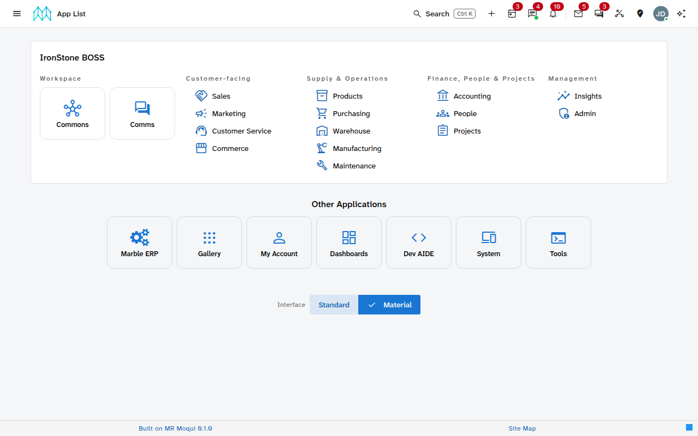
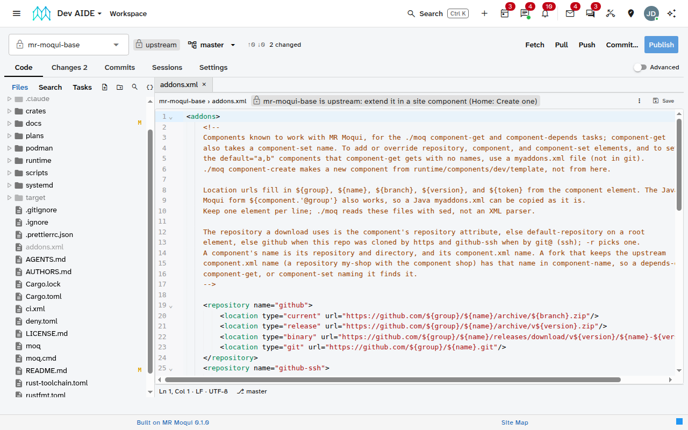

# MR Moqui - Modern Rust Moqui Framework

> **Not ready for production (before 0.1.0).** MR Moqui is in early design and development. Until the first release,
> the 0.1.0 series:
>
> - **Stability.** The data model (entities, their groups and fields) and the storage layout (databases, schemas,
>   where files are kept) are not stable. They change without migrations, and a database from an earlier build may
>   need to be emptied and loaded again (`./moq clean-db`, `./moq load`).
> - **Security.** Run it only on development machines, with no real business data or credentials, and do not expose
>   it to the internet. A security review is under way. Until 0.1.0 its findings, open vulnerabilities included, are
>   recorded openly in this repository ([plans/Security-Review.md](plans/Security-Review.md),
>   [docs/security/](docs/security/Attack-Surface.md)): with no production systems to protect, the repository is the
>   project's internal disclosure. From 0.1.0 the project follows Moqui Java's policy: a vulnerability is reported
>   privately to the board ([SECURITY.md](SECURITY.md)) and kept in the board's private repository until it is fixed.

Moqui is a framework for building business applications. An application is a component made of artifacts written in
XML: entities for the data model, services for the logic, and screens and forms for the user interface, with rules
that run on data and service events, and data files. The framework does the work every such application needs:
persistence and transactions, security, caching, search, localization, scheduled jobs, REST, and rendering a screen
to whatever is asking for it.

MR Moqui is that framework rebuilt in Rust. It builds to one binary that carries its own Postgres, so a clone, a build
and a run give a working system. Scripts and templates are JavaScript, on the server and in the browser, so one
screen definition renders as a web page, in the browser client, or in a terminal. The applications are components
in repositories of their own: a business suite, a public-facing suite, and the ERP ported from Moqui Java, listed
under [Applications](#applications).



## Quick Start

```sh
git clone https://github.com/moqui/mr-moqui.git
cd mr-moqui
./moq component-get apps   # Optional: the applications (Marble ERP, IronStone BOSS and PASS, with Mantle)
./moq build                # Every feature and the dev tools; --lite for a smaller, quicker build
./moq load                 # Load all data, including demo; the first run on an empty database loads it too
./moq run                  # Start moqui; logs to console, ctrl-c to stop; default ports 8080 and 8443
```

Open `http://localhost:8080` and sign in as `john.doe` with the password `moqui`.

It needs Rust 1.99 or newer, git and bash, on Linux, macOS, or Windows ([Build](docs/Build-Test.md#build)). On
Windows, use the MSVC toolchain, Visual Studio Build Tools and Git for Windows, and `moq.cmd` from PowerShell or cmd
([Windows](docs/Build-Test.md#windows)). The first build takes a few minutes and downloads the embedded Postgres
archive once. It makes the release binary (`target/release/moqui`, the Maximal
[package](docs/Build-Test.md#packages): every feature, embedded Postgres and the dev tools), which `./moq` then uses
to load data and run. To deploy to a server, a container or a cluster, see [Run and Deploy](docs/Run-Deploy.md).

## What is in the framework

- **Artifacts in XML.** Entities, services, screens and forms, entity and service ECA rules, REST APIs and data
  files, with JavaScript where a script is needed
  ([application practices](docs/dev/Practices-App-Dev.md), the [JavaScript API](docs/README.md#dev-developing-on-mr-moqui)).
- **One screen, several renderings.** The Vue and Quasar client at `/qapps` ([Qvt-Client](docs/ui/Qvt-Client.md)),
  plain HTML at `/apps`, a terminal UI that also runs over SSH ([TUI](docs/ui/TUI.md)), print HTML sent as PDF, and
  CSV and XLSX ([render modes](docs/dev/JS-Templates-Macros.md)).
- **Postgres built in.** An embedded Postgres when no database is configured, an external Postgres or MySQL when one
  is; search on Postgres full text and JSON, with OpenSearch optional
  ([Database and search](docs/Run-Deploy.md#database-and-search)).
- **Administration apps.** System, Tools and Dashboards: users and access, the conf, jobs, data and SQL, schema, ETL,
  monitoring and reports ([Database](docs/tools/Database.md), [Monitoring](docs/tools/Monitoring.md),
  [Component-Deploy](docs/tools/Component-Deploy.md)).
- **Communication.** Mail (SMTP, IMAP, POP), chat, and voice and video calls in the Comms app, with SIP trunks,
  voicemail, SMS and XMPP ([Comms](docs/tools/Comms.md), [docs/interfaces](docs/README.md#interfaces-system-interfaces)).
- **Files and sync.** CalDAV, CardDAV, WebDAV and SFTP for phones and desktop apps ([Sync](docs/interfaces/Sync.md)).
- **Git hosting and CI.** Repositories over HTTPS and SSH with merge requests, and pipelines on Docker or Podman
  runners ([Git-Hosting](docs/interfaces/Git-Hosting.md), [Pipelines](docs/interfaces/Pipelines.md)).
- **Agents and models.** The Assist drawer, whose writes wait for the user's approval, an MCP server and client, an
  A2A server and client, and an OpenAI-compatible gateway ([Assist](docs/ai/Assist.md), [MCP](docs/ai/MCP.md),
  [A2A](docs/ai/A2A.md), [Gateway](docs/ai/Gateway.md)).
- **Clients.** A desktop app and an Android app that work with a server, offline too
  ([Desktop-Client](docs/ui/Desktop-Client.md), [Mobile-Client](docs/ui/Mobile-Client.md)).
- **Deployment.** One server, a container, a cluster that coordinates through the shared database, and an edge node
  in front of a server with no public port ([Run and Deploy](docs/Run-Deploy.md#choose-a-topology)).
- **Developer tools.** Dev AIDE, an IDE in the browser at `/qapps/dev`
  ([README](runtime/components/dev/dev-aide/README.md)); type declarations, `check`, `lint` and a language server
  ([JS-Types-Tooling](docs/dev/JS-Types-Tooling.md)); server and browser specs and load scripts in JavaScript
  ([JS-Testkit](docs/dev/JS-Testkit.md), [JS-Test-Client](docs/dev/JS-Test-Client.md),
  [Load-Runner](docs/tools/Load-Runner.md)).
- **Native components.** A component can add Rust beside its XML: services, tools, resource schemes and template
  renderers in a `Cargo.toml` and `src/` next to its `component.xml`, which `./moq build` links into the binary
  ([Native-Components](docs/dev/Native-Components.md); `runtime/components/dev/example` has one of each, and the
  screen archetype gallery at `/qapps/gallery`).



## Applications

Each application is a component in its own repository in the [moqui](https://github.com/moqui) organization, checked
out under `runtime/components/addon/`. The repository, its directory and its `component.xml` name are the same.

| Repository | What it is | State |
|---|---|---|
| [mr-mantle](https://github.com/moqui/mr-mantle) | Mantle Business Artifacts: the business data model and the service library the applications share | Built |
| [mr-boss](https://github.com/moqui/mr-boss) | IronStone BOSS, the Business OS Suite: sixteen apps in one shell, from Commons and Comms (groupware and communication) through Sales, Warehouse, Accounting and People | Built |
| [mr-pass](https://github.com/moqui/mr-pass) | IronStone PASS, the Public Application Software Suite: Forum, Shop, Smithy (git hosting), and the customer and supplier pages of the BOSS apps | Built |
| [mr-marble](https://github.com/moqui/mr-marble) | Marble ERP and the Simple Screens library it is built from, ported from Moqui Java | Ported |
| [mr-l10n](https://github.com/moqui/mr-l10n) | Language packs: Spanish and Simplified Chinese | Covers the framework, Mantle, Marble and nine BOSS apps |
| [mr-home](https://github.com/moqui/mr-home) | IronStone HOME: BOSS's capabilities for a household | In design |
| [mr-three](https://github.com/moqui/mr-three) | IronStone THREE: 3D in business screens, and a town to walk through to reach them | In design |

```sh
./moq component-get apps      # The 'apps' set: mr-marble, mr-boss and mr-pass, and mr-mantle, which they depend on
./moq component-get mr-boss   # One component and what it depends on
./moq component-get mr-l10n mr-home mr-three
./moq git-pull                # Pull this repository and each component's
```

## Status

The framework is built and the applications above run on it. Before the first release, work continues on the
security review, on mail and agent features that have run against few live providers and models so far, on reviewing
the newer screens in the browser, on Moqui Java functionality not yet covered, and on tests and fixes. Performance is
the phase after that. What is open is in [plans/Remaining-Work.md](plans/Remaining-Work.md), and what follows 0.1.0 in
[plans/Future-Plans.md](plans/Future-Plans.md).

## Coming from Moqui Java

MR Moqui is a rebuild of Moqui Java ([moqui-framework](https://github.com/moqui/moqui-framework) and
[moqui-runtime](https://github.com/moqui/moqui-runtime)). Most of it follows the Java framework as it was when the
work began: the XML artifacts carry over, and the ExecutionContext and its facades keep their shape. Groovy scripts
and FreeMarker templates become JavaScript, and the `moq` script replaces the Gradle tasks. To move a deployment or a
component, start with the [Moqui Java migration notes](docs/dev/Moqui-Java-Migration.md), which also have the
component and repository renames.

| Repository | Where it came from |
|---|---|
| [mr-moqui](https://github.com/moqui/mr-moqui) | [moqui-framework](https://github.com/moqui/moqui-framework) and [moqui-runtime](https://github.com/moqui/moqui-runtime) |
| [mr-mantle](https://github.com/moqui/mr-mantle) | [mantle-udm](https://github.com/moqui/mantle-udm) and [mantle-usl](https://github.com/moqui/mantle-usl), converted from Groovy to JavaScript and merged with the history of both |
| [mr-marble](https://github.com/moqui/mr-marble) | [SimpleScreens](https://github.com/moqui/SimpleScreens) and [MarbleERP](https://github.com/moqui/MarbleERP), merged with the history of both |
| mr-boss, mr-pass, mr-home, mr-three, mr-l10n | New for MR Moqui |

A Java component that depends on `mantle-udm`, `mantle-usl`, `SimpleScreens` or `MarbleERP` now depends on
`mr-mantle` or `mr-marble`, and its `component://` locations change the same way.

### Design goals

- Keep XML as the spec language for configuration, entities, services, screens, SECAs, and data files, with only the adaptations required by a Rust runtime.
- Move the heavy lifting (entity facade, service facade, screen rendering, tooling, and performance-sensitive service implementations) into Rust.
- Use one language (JavaScript) for scripts and templates on the server, and for inline expressions on the client, so that XML Screens can become client-renderable. The engine is [quickjs-oxide](https://github.com/moqui/quickjs-oxide), a QuickJS-compatible engine in safe Rust.
- Default to an embedded Postgres (`postgresql_embedded`, theseus) when no external database is configured, and use an external Postgres when one is. The same engine backs the sim-mode overlay.
- Keep OpenSearch optional: the search interface is satisfied by Postgres full-text search and JSON operators.
- Preserve the ExecutionContext / facade shape that makes Moqui’s artifact model work.

### Significant redesigns

These are the places that change on purpose.

1. **JavaScript for scripts and templates.** Scripts, XML actions, screen macros and text templates are JavaScript on quickjs-oxide; `ec.resource.expand()` is a template literal, and a small `if`/`list`/`assign` renderer (with a locked-down sandbox variant) handles structured text. Plan: [Architecture-Proposal](plans/archive/Architecture-Proposal.md) (Templating).
2. **SearchFacade replaces ElasticFacade.** Postgres full-text and JSON are the default backend; OpenSearch is optional. Plan: [SearchFacade](plans/archive/SearchFacade.md).
3. **qvt can be server-static.** With `server-static` set for `qvt`, the server sends a data-free compiled template and the client merges the data. Opt-in. Plan: [QvtServerStatic](plans/archive/QvtServerStatic.md).
4. **Print HTML is its own render mode.** `html-print` (print CSS and `@page`, also selected by the old `xsl-fo` name) is printed to PDF by one long-lived external Chromium; `/fop/<path>` sends a screen as PDF. Plan: [Architecture-Proposal](plans/archive/Architecture-Proposal.md) (Tool components and print).
5. **Cluster coordination uses the shared database.** Members find each other in a table; cache invalidation and notifications fan out over gRPC on client-certificate TLS (HTTP/1.1 POST as the alternative); no Hazelcast or Redis. Plan: [Cluster](plans/archive/Cluster.md).
6. **Sessions live in the database** (`moqui.server.HttpSession`, through the entity cache), with an optional guarantee mode so a load balancer without stickiness can fail over. Plan: [Architecture-Proposal](plans/archive/Architecture-Proposal.md) (Sessions and login).
7. **Keys are configuration, and unset secrets are generated.** Secrets are conf attributes, set by conf file or environment, never database rows; one still at its `CHANGEME` default is generated and saved to `runtime/.env`, which is loaded at startup like environment variables. Plan: [MimoReview](plans/archive/MimoReview.md) (Decisions 1–3).
8. **Feed registration commits with the entity change.** Search document keys are registered in the entity transaction; assembly and indexing run after commit, and an index failure does not roll back the change. Plan: [SearchFacade](plans/archive/SearchFacade.md).
9. **Settings by conf path.** Every setting is an attribute of a conf element with its default written there; Moqui
   Java's `default-property` entries and the `${name}` references to them are gone. Any attribute is set from the
   environment by a name built from its XML path (`moqui_conf__webapp_list__webapp__WEBROOT__http_port`), and named
   elsewhere by the same path as a selector (`webapp-list/webapp[webroot]@http-port`); a component declares a
   top-level element of its own. Guide: [Run-Deploy](docs/Run-Deploy.md#settings-and-the-environment); plan:
   [Conf-Paths](plans/archive/Conf-Paths.md).

## Documentation

Reference guides for built features are in [`docs/`](docs/), by tier and area with an index in
[`docs/README.md`](docs/README.md). The two most people start with:

- [Build and Test](docs/Build-Test.md): building from source, the build packages and their features, the `./moq`
  tasks, the Rust tests and component specs, and the checks to run before a commit and before a release
  ([Validation](docs/Build-Test.md#validation)).
- [Run and Deploy](docs/Run-Deploy.md): the runtime directory and conf, HTTPS certificates and ports, production
  archives, clusters, and PASS and team topologies; Podman and systemd are in [`podman/README.md`](podman/README.md).

The practices for [application development](docs/dev/Practices-App-Dev.md) and [Rust](docs/dev/Practices-Rust.md)
are in `docs/dev/`. The [security policy](SECURITY.md) links to the attack-surface map and the HTTP proof tests.
Design, status and review documents are in [`plans/`](plans/), indexed by [`plans/README.md`](plans/README.md): what
is still open, what comes next, the proposals, and the archive of built designs and finished reviews.

## AI/LLM Policy

Moqui was originally designed and built largely to reduce the human pain and suffering involved with building and maintaining enterprise applications. The same philosophy applies to the world of AI, from LLMs to harnesses, and from harnesses used to make Moqui to those built into it.

This project is an AI-assisted rebuild of the manually written Moqui Framework in Rust. It would likely never be done without AI assistance migrating and filling in code. AI assistance to migrate existing components made for Moqui is also recommended. Without that being available, migration from Groovy to JavaScript would be a much more expensive thing to do and it is much less likely we'd ever do it.

LLMs are considered tools used by people. The person using the tool is just as responsible as with a text editor and keyboard. LLMs are the functional and moral equivalent of a hammer: they do not shake themselves, and are not a substitute or replacement for a responsible party.

Don't trust, verify. Use AI to help verify, but remember who is responsible, and who is a who.

## License and Contributing

[CC0 1.0 Universal with a Grant of Patent License](LICENSE.md).

Code is accepted from people who have signed [AUTHORS.md](AUTHORS.md), in a commit from the GitHub account that submits the pull request. From an account that has not signed, we may take a pull request's ideas but not its code, which is written again with AI assistance. Each mr-* repository has its own AUTHORS.md, and maintainers follow [Contributions](docs/dev/Contributions.md).
