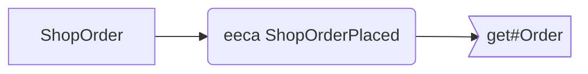

# ShopEntities.eecas

Up: [ECA rules](../README.md) · [All artifacts](../../README.md)

- **Rules file:** `component://autodoc-shop/entity/ShopEntities.eecas.xml` (autodoc-shop)
- **Rules:** 1

## What the rules run on and call



## eeca ShopOrderPlaced

- **Kind:** eeca · line 3 · **On:** [`shop.order.ShopOrder`](../../entity/shop/order/ShopOrder.md)
- `entity`: `shop.order.ShopOrder`
- `on-create`: `true`
- **Calls:** [get#Order](../../service/shop/OrderServices/get-Order.md)

Look the order up again after it is created.

Actions:

```xml
<service-call name="shop.OrderServices.get#Order" in-map="{orderId: orderId}"/>
```
