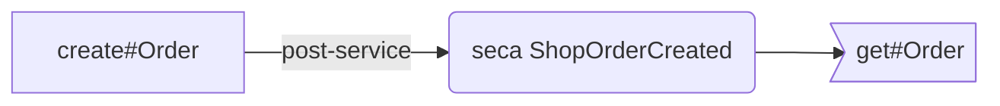

# OrderServices.secas

Up: [ECA rules](../../README.md) · [All artifacts](../../../README.md)

- **Rules file:** `component://autodoc-shop/service/shop/OrderServices.secas.xml` (autodoc-shop)
- **Rules:** 1

## What the rules run on and call



## seca ShopOrderCreated

- **Kind:** seca · line 3 · **On:** [`shop.OrderServices.create#Order`](../../../service/shop/OrderServices/create-Order.md)
- `service`: `shop.OrderServices.create#Order`
- `when`: `post-service`
- **Calls:** [get#Order](../../../service/shop/OrderServices/get-Order.md)

Read the new order.

Condition:

```js
orderId
```

Actions:

```xml
<service-call name="shop.OrderServices.get#Order" in-map="{orderId: orderId}"/>
```
