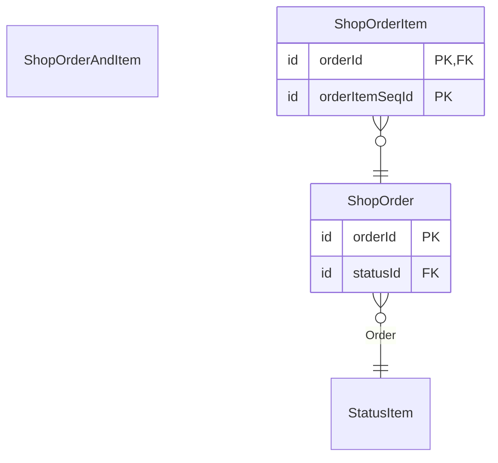

# Package `shop.order`

Up: [Entities](../../README.md) · [All artifacts](../../../README.md)

## Entities

| Entity | Summary |
|---|---|
| [ShopOrder](ShopOrder.md) | An order placed in the shop |
| [ShopOrderAndItem](ShopOrderAndItem.md) | Orders with their items |
| [ShopOrderItem](ShopOrderItem.md) | A line of an order |

## Entities and relationships

