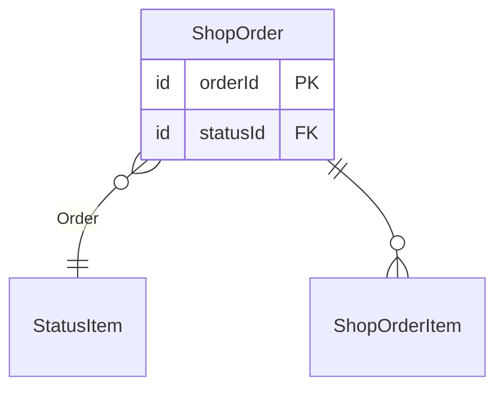
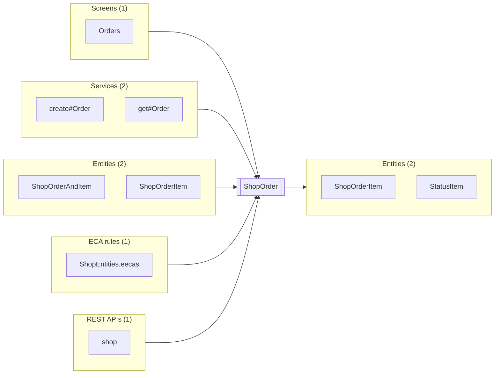

# ShopOrder

Up: [shop.order](README.md) · [All artifacts](../../../README.md)

- **Entity:** `shop.order.ShopOrder`
- **Defined in:** `component://autodoc-shop/entity/ShopEntities.xml` line 4 (autodoc-shop)
- **Table:** `SHOP_ORDER` · **Cache:** never
- **Primary key:** `orderId`

An order placed in the shop.

One per checkout; its items are ShopOrderItem records.

## Fields

| Field | Type | PK | Not null | Default | Description | From |
|---|---|---|---|---|---|---|
| `orderId` | `id` | yes |  |  | The order's id, \| a pipe and *stars*. |  |
| `statusId` | `id` |  |  |  |  |  |
| `placedDate` | `date-time` |  | yes |  |  |  |
| `grandTotal` | `currency-amount` |  |  | `0` |  |  |
| `siteNote` | `text-medium` |  |  |  | A note the site keeps. | autodoc-site |
| `lastUpdatedStamp` | `date-time` |  |  |  |  |  |

## Relationships

| Type | Related | Title | Key map | Description |
|---|---|---|---|---|
| one | StatusItem | Order | `statusId` | Where the order is in its flow. |
| many | [ShopOrderItem](ShopOrderItem.md) |  | `orderId` |  |

## Indexes

| Index | Unique | Fields |
|---|---|---|
| `SHOP_ORDER_PLACED` |  | `placedDate` |

## Extensions

| Component | File |
|---|---|
| autodoc-site | `component://autodoc-site/entity/SiteEntities.xml` line 3 |

## ECA rules

| Rule | On |
|---|---|
| [eeca ShopOrderPlaced](../../../eca/entity/ShopEntities.eecas.md) | shop.order.ShopOrder |

## Used by and uses

### Used by

**Screens** (1)

| Name | Full name | How |
|---|---|---|
| [Orders](../../../screen/Shop/Orders.autodoc-shop.md) | `component://autodoc-shop/screen/Shop/Orders.xml` | econdition, entity-find |

**Services** (2)

| Name | Full name | How |
|---|---|---|
| [create#Order](../../../service/shop/OrderServices/create-Order.md) | `shop.OrderServices.create#Order` | entity-make-value |
| [get#Order](../../../service/shop/OrderServices/get-Order.md) | `shop.OrderServices.get#Order` | entity-find-one |

**Entities** (2)

| Name | Full name | How |
|---|---|---|
| [ShopOrderAndItem](ShopOrderAndItem.md) | `shop.order.ShopOrderAndItem` | member-entity in view-member ORD |
| [ShopOrderItem](ShopOrderItem.md) | `shop.order.ShopOrderItem` | relationship |

**ECA rules** (1)

| Name | Full name | How |
|---|---|---|
| [ShopEntities.eecas](../../../eca/entity/ShopEntities.eecas.md) | `component://autodoc-shop/entity/ShopEntities.eecas.xml` | extend |

**REST APIs** (1)

| Name | Full name | How |
|---|---|---|
| [shop](../../../rest/shop.md) | `component://autodoc-shop/service/shop.rest.xml` | rest |

### Uses

**Entities** (2)

| Name | Full name | How |
|---|---|---|
| [ShopOrderItem](ShopOrderItem.md) | `shop.order.ShopOrderItem` | relationship |
| StatusItem | `moqui.basic.StatusItem` | relationship |
