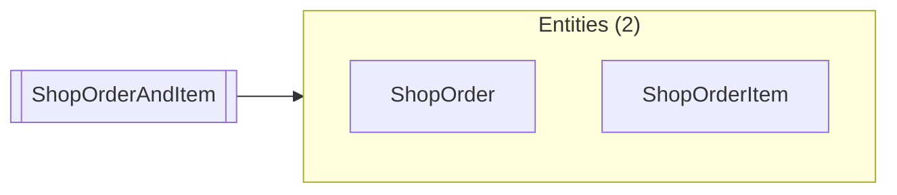

# ShopOrderAndItem

Up: [shop.order](README.md) · [All artifacts](../../../README.md)

- **View entity:** `shop.order.ShopOrderAndItem`
- **Defined in:** `component://autodoc-shop/entity/ShopEntities.xml` line 28 (autodoc-shop)
- **Primary key:** `orderId`

Orders with their items.

## Fields

## Member entities

| Alias | Entity | Joined from | Optional | Key map |
|---|---|---|---|---|
| `ORD` | [shop.order.ShopOrder](ShopOrder.md) |  |  |  |
| `ITM` | [shop.order.ShopOrderItem](ShopOrderItem.md) | `ORD` |  | `orderId` |

## Aliases

| Alias | Member | Field | Function |
|---|---|---|---|
| `quantity` | `ITM` |  |  |

## Used by and uses

### Used by

None.

### Uses

**Entities** (2)

| Name | Full name | How |
|---|---|---|
| [ShopOrder](ShopOrder.md) | `shop.order.ShopOrder` | member-entity |
| [ShopOrderItem](ShopOrderItem.md) | `shop.order.ShopOrderItem` | member-entity |
