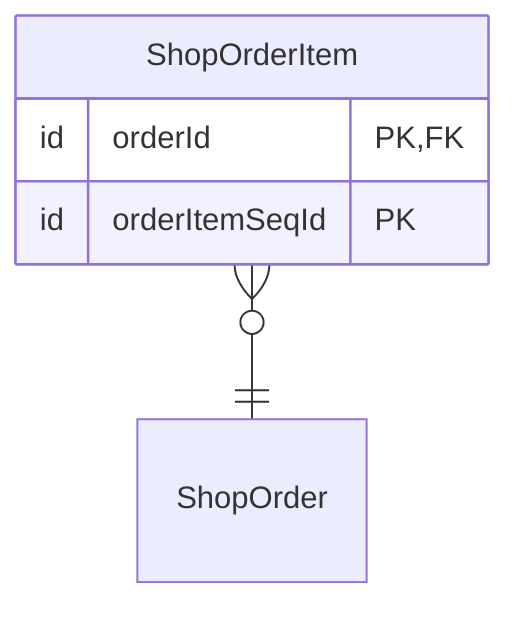
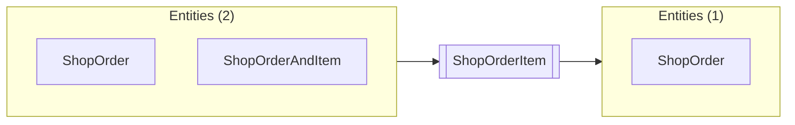

# ShopOrderItem

Up: [shop.order](README.md) · [All artifacts](../../../README.md)

- **Entity:** `shop.order.ShopOrderItem`
- **Defined in:** `component://autodoc-shop/entity/ShopEntities.xml` line 21 (autodoc-shop)
- **Table:** `SHOP_ORDER_ITEM` · **Cache:** false
- **Primary key:** `orderId, orderItemSeqId`

A line of an order.

## Fields

| Field | Type | PK | Not null | Default | Description |
|---|---|---|---|---|---|
| `orderId` | `id` | yes |  |  |  |
| `orderItemSeqId` | `id` | yes |  |  |  |
| `quantity` | `number-decimal` |  |  |  |  |
| `lastUpdatedStamp` | `date-time` |  |  |  |  |

## Relationships

| Type | Related | Title | Key map | Description |
|---|---|---|---|---|
| one | [ShopOrder](ShopOrder.md) |  | `orderId` |  |

## Used by and uses

### Used by

**Entities** (2)

| Name | Full name | How |
|---|---|---|
| [ShopOrder](ShopOrder.md) | `shop.order.ShopOrder` | relationship |
| [ShopOrderAndItem](ShopOrderAndItem.md) | `shop.order.ShopOrderAndItem` | member-entity in view-member ITM |

### Uses

**Entities** (1)

| Name | Full name | How |
|---|---|---|
| [ShopOrder](ShopOrder.md) | `shop.order.ShopOrder` | relationship |
