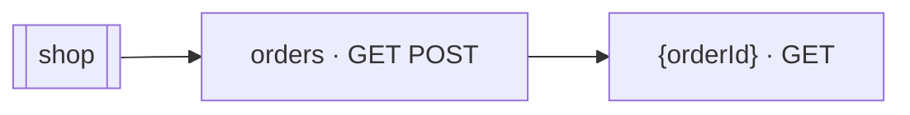

# Shop REST API

Up: [REST APIs](README.md) · [All artifacts](../README.md)

- **REST API:** `/rest/s1/shop` · **Version:** 1.0
- **Defined in:** `component://autodoc-shop/service/shop.rest.xml` (autodoc-shop)

Orders of the shop.

## Resources

## Methods

| Resource | Method | Calls | Description |
|---|---|---|---|
| `/shop/orders` | GET | entity [`shop.order.ShopOrder`](../entity/shop/order/ShopOrder.md) list | The shop's orders |
| `/shop/orders` | POST | service [`shop.OrderServices.create#Order`](../service/shop/OrderServices/create-Order.md) | The shop's orders |
| `/shop/orders/{orderId}` | GET | service [`shop.OrderServices.get#Order`](../service/shop/OrderServices/get-Order.md) |  |
