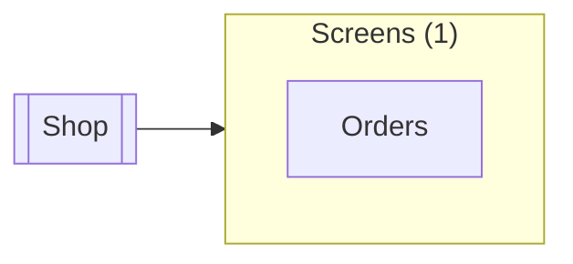

# Shop

Up: [Screens](README.md) · [All artifacts](../README.md)

- **Screen:** `component://autodoc-shop/screen/Shop.xml`
- **Menu title:** Shop
- **Render modes:** all · **Server static:** all · **Requires login:** true

The shop app: its orders.

## Subscreens

| Item | Menu title | Index | Screen |
|---|---|---|---|
| `Orders` *(default)* | Orders | 1 | [`component://autodoc-shop/screen/Shop/Orders.xml`](Shop/Orders.autodoc-shop.md) |

## Used by and uses

### Used by

None.

### Uses

**Screens** (1)

| Name | Full name | How |
|---|---|---|
| [Orders](Shop/Orders.autodoc-shop.md) | `component://autodoc-shop/screen/Shop/Orders.xml` | subscreens-item |
