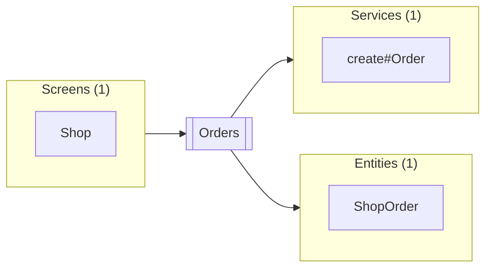

# Orders

Up: [Shop](README.md) · [All artifacts](../../README.md)

- **Screen:** `component://autodoc-shop/screen/Shop/Orders.xml`
- **Menu title:** Orders
- **Render modes:** all · **Requires login:** true

The orders of the shop, with Create order.

## Parameters

| Parameter | Required | From |
|---|---|---|
| `statusId` |  |  |

## Transitions

| Transition | Method | Service | Response |
|---|---|---|---|
| `createOrder` | any | [`shop.OrderServices.create#Order`](../../service/shop/OrderServices/create-Order.md) | `.` |

## Forms

| Form | Type | Fields |
|---|---|---|
| `OrderList` | form-list | orderId, grandTotal |

## Used by and uses

### Used by

**Screens** (1)

| Name | Full name | How |
|---|---|---|
| [Shop](../Shop.md) | `component://autodoc-shop/screen/Shop.xml` | subscreens-item in subscreen Orders |

### Uses

**Services** (1)

| Name | Full name | How |
|---|---|---|
| [create#Order](../../service/shop/OrderServices/create-Order.md) | `shop.OrderServices.create#Order` | service-call |

**Entities** (1)

| Name | Full name | How |
|---|---|---|
| [ShopOrder](../../entity/shop/order/ShopOrder.md) | `shop.order.ShopOrder` | econdition in field statusId, entity-find |
