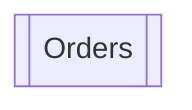

# Orders

Up: [Shop](README.md) · [All artifacts](../../README.md)

- **Screen:** `component://autodoc-site/screen/Shop/Orders.xml`
- **Menu title:** Site orders
- **Render modes:** all · **Requires login:** true

The site's own orders page, at the same path as the shop's.

## Used by and uses

### Used by

None.

### Uses

None.
