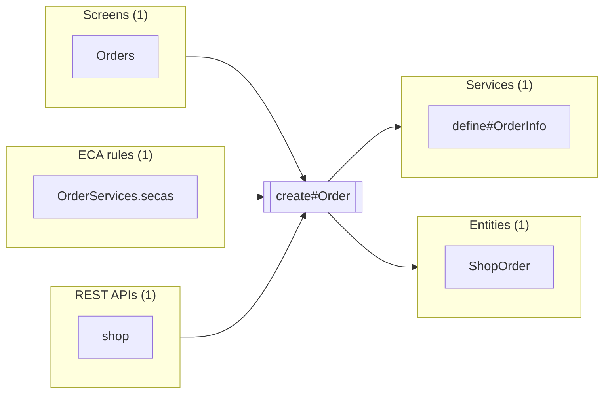

# create#Order

Up: [OrderServices](../OrderServices.md) · [All artifacts](../../../README.md)

- **Service:** `shop.OrderServices.create#Order`
- **Defined in:** `component://autodoc-shop/service/shop/OrderServices.xml` line 14 (autodoc-shop)
- **Type:** inline
- **Authenticate:** true · **Transaction:** use-or-begin
- **Implements:** [`shop.OrderServices.define#OrderInfo`](define-OrderInfo.md)

Create an order with its items.

Refuses an order with no items.

## In parameters

| Parameter | Type | Required | Default | Description |
|---|---|---|---|---|
| `statusId` | `String` |  |  | The order's first status. |
| `items` | `List` | yes |  |  |
| `items.item` | `Map` |  |  |  |
| `items.item.quantity` | `BigDecimal` |  |  |  |

## Out parameters

| Parameter | Type | Required | Default | Description |
|---|---|---|---|---|
| `orderId` | `String` |  |  |  |

## Used by and uses



### Used by

**Screens** (1)

| Name | Full name | How |
|---|---|---|
| [Orders](../../../screen/Shop/Orders.autodoc-shop.md) | `component://autodoc-shop/screen/Shop/Orders.xml` | service-call in transition createOrder |

**ECA rules** (1)

| Name | Full name | How |
|---|---|---|
| [OrderServices.secas](../../../eca/service/shop/OrderServices.secas.md) | `component://autodoc-shop/service/shop/OrderServices.secas.xml` | extend |

**REST APIs** (1)

| Name | Full name | How |
|---|---|---|
| [shop](../../../rest/shop.md) | `component://autodoc-shop/service/shop.rest.xml` | rest |

### Uses

**Services** (1)

| Name | Full name | How |
|---|---|---|
| [define#OrderInfo](define-OrderInfo.md) | `shop.OrderServices.define#OrderInfo` | implements |

**Entities** (1)

| Name | Full name | How |
|---|---|---|
| [ShopOrder](../../../entity/shop/order/ShopOrder.md) | `shop.order.ShopOrder` | entity-make-value |

## Definition

```xml
<service verb="create" noun="Order" type="inline">
    <in-parameters>
        <parameter name="statusId">
            <description><![CDATA[The order's first status.]]></description></parameter>
        <parameter name="items" type="List" required="true">
            <parameter name="item" type="Map">
                <parameter name="quantity" type="BigDecimal"/></parameter></parameter>
    </in-parameters>
    <out-parameters>
        <parameter name="orderId"/></out-parameters>
    <actions>
        <entity-make-value entity-name="shop.order.ShopOrder" value-field="order"/>
        <entity-sequenced-id-primary value-field="order"/>
        <entity-create value-field="order"/>
        <set field="orderId" from="order.orderId"/>
    </actions>
</service>
```
