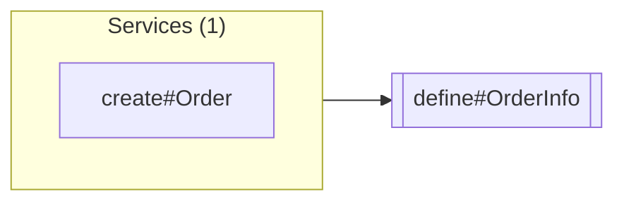

# define#OrderInfo

Up: [OrderServices](../OrderServices.md) · [All artifacts](../../../README.md)

- **Service:** `shop.OrderServices.define#OrderInfo`
- **Defined in:** `component://autodoc-shop/service/shop/OrderServices.xml` line 8 (autodoc-shop)
- **Type:** interface
- **Authenticate:** true · **Transaction:** use-or-begin

The parameters an order service takes.

## In parameters

| Parameter | Type | Required | Default | Description |
|---|---|---|---|---|
| `statusId` | `String` |  |  | The order's first status. |

## Out parameters

None.

## Used by and uses



### Used by

**Services** (1)

| Name | Full name | How |
|---|---|---|
| [create#Order](create-Order.md) | `shop.OrderServices.create#Order` | implements |

### Uses

None.

## Definition

```xml
<service verb="define" noun="OrderInfo" type="interface">
    <in-parameters>
        <parameter name="statusId">
            <description><![CDATA[The order's first status.]]></description></parameter></in-parameters></service>
```
