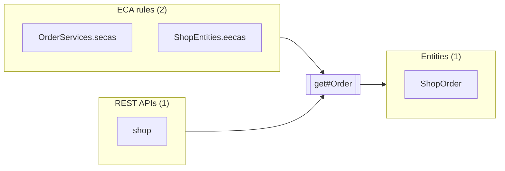

# get#Order

Up: [OrderServices](../OrderServices.md) · [All artifacts](../../../README.md)

- **Service:** `shop.OrderServices.get#Order`
- **Defined in:** `component://autodoc-shop/service/shop/OrderServices.xml` line 32 (autodoc-shop)
- **Type:** inline
- **Authenticate:** true · **Transaction:** use-or-begin

## In parameters

| Parameter | Type | Required | Default | Description |
|---|---|---|---|---|
| `orderId` | `String` | yes |  |  |

## Out parameters

| Parameter | Type | Required | Default | Description |
|---|---|---|---|---|
| `order` | `Map` |  |  |  |

## Used by and uses



### Used by

**ECA rules** (2)

| Name | Full name | How |
|---|---|---|
| [OrderServices.secas](../../../eca/service/shop/OrderServices.secas.md) | `component://autodoc-shop/service/shop/OrderServices.secas.xml` | service-call |
| [ShopEntities.eecas](../../../eca/entity/ShopEntities.eecas.md) | `component://autodoc-shop/entity/ShopEntities.eecas.xml` | service-call |

**REST APIs** (1)

| Name | Full name | How |
|---|---|---|
| [shop](../../../rest/shop.md) | `component://autodoc-shop/service/shop.rest.xml` | rest |

### Uses

**Entities** (1)

| Name | Full name | How |
|---|---|---|
| [ShopOrder](../../../entity/shop/order/ShopOrder.md) | `shop.order.ShopOrder` | entity-find-one |

## Definition

```xml
<service verb="get" noun="Order" type="inline">
    <in-parameters>
        <parameter name="orderId" required="true"/></in-parameters>
    <out-parameters>
        <parameter name="order" type="Map"/></out-parameters>
    <actions>
        <entity-find-one entity-name="shop.order.ShopOrder" value-field="order"/></actions>
</service>
```
