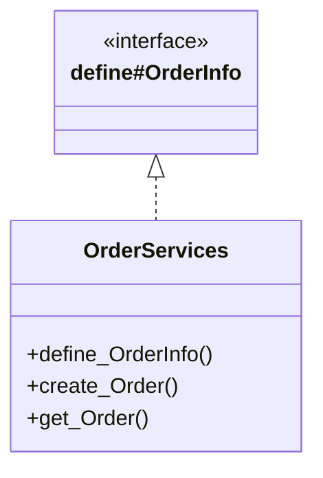

# Services in `shop`

Up: [Services](../README.md) · [All artifacts](../../README.md)

## Service files

| File | Services | Component |
|---|---|---|
| [OrderServices](OrderServices.md) | 3 | autodoc-shop |

## Files, services and interfaces

