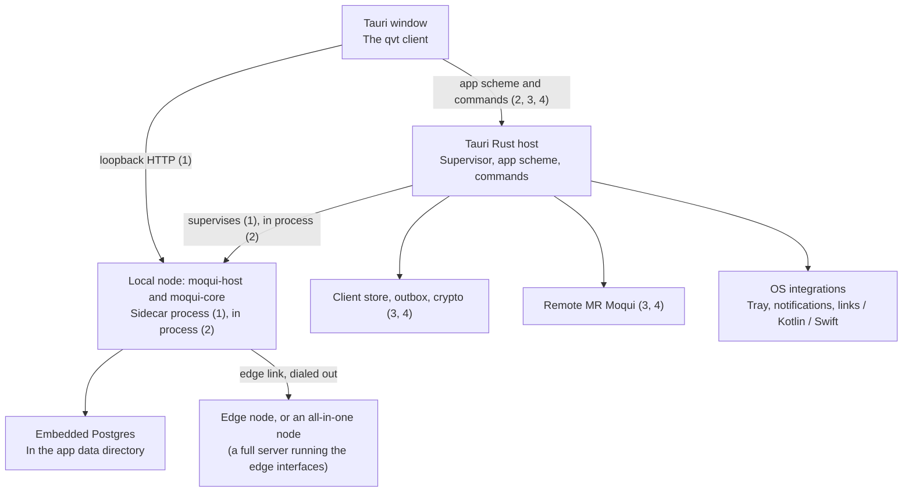

# Mobile and Desktop Clients

Status 2026-11-02: tentative implementation plan, reviewed against the code, [Edge-Node](Edge-Node.md) and [Comms-Framework](Comms-Framework.md). Build order:

1. A desktop local node in a Tauri 2 app: the `moqui` server as a sidecar, linked as an Edge Client.
2. The same full node in the app's own process.
3. An offline-capable client of a remote server, with synchronization.
4. An Android app on that client model, then iOS.

The mobile host is confirmed at MT5; Capacitor is the alternative. No packaged client or platform performance results are claimed here.

## 1. Direction and rationale

Build a locally installed desktop application with the existing Vue/Quasar UI and a Rust host, in this order:

1. **Desktop local node.** The app installs and supervises the regular `moqui` server as a sidecar process. It is the system of record, on embedded Postgres. It links as an Edge Client to an [edge node](Edge-Node.md), or to an all-in-one node: a full server that also runs the edge interfaces ([Edge-Node §10](Edge-Node.md#10-all-in-one-node-e12), E12). Its window shows the node's own apps.
2. **In-process full node.** The same node boots inside the app's process and opens no port, as `moqui tui` does.
3. **Offline-capable client.** A bundled client of a remote server, with local data, queued operations and synchronization.
4. **Mobile.** An Android app on the offline-capable client model, then iOS.

The first two steps give a person, household or small business the whole framework on their own computer. It is offline by holding the data, and it has public reach through the edge. The last two reach servers the user does not run on that computer, and phones.

The main reasons for this direction are:

- **Reuse:** preserve the Vue/Quasar components, JavaScript libraries, screen contracts, and application behavior already used by the web client. Avoid maintaining a second default UI in React or native widgets.
- **Rust performance and memory management:** put suitable storage, synchronization, cryptography, and local framework work in native Rust, consistent with the reasons for using Rust in MR Moqui. Control allocations, ownership, concurrency, and cache sizes in these paths.
- **Architectural flexibility:** a local node, a client with offline data and queued operations, and a remote client share one app and host. A complete server installation that the user manages separately should not be a prerequisite for opening the application.
- **Platform reach:**
  - Linux and macOS first, where the `moqui` binary is built and run today.
  - Windows after: embedded Postgres runs there, but it is a lower-priority target.
  - Android, then iOS.
  - Platform-specific work sits behind explicit adapters.

Tauri accepts web frontends and a Rust backend, with Swift/Kotlin available for platform integration. It uses the platform WebView, so the app does not ship its own browser engine. These are useful architectural properties, but they do not show that this application will start faster or use less memory than every alternative. [Tauri overview](https://v2.tauri.app/start/).

The Tauri build needs no Node. The `cargo tauri` CLI packages a static frontend directory, and `app.withGlobalTauri` gives the page `window.__TAURI__`, which fits the vendored global-script webroot as it is ([Node dependency](archive/NodeDependency.md)).

Here, a **bundled screen** is installed with the application and can open without downloading its UI from a server. It remains a Vue/Quasar DOM interface inside a WebView. Native OS behavior, such as incoming-call integration, comes from platform APIs; bundling a screen does not turn its controls into UIKit or Android widgets.

## 2. Existing foundation and gaps

The broader host-portability direction is in [Cross-Platform Usability](proposals/Usability.md). This plan makes the desktop/mobile client choice concrete while preserving the existing web and browser-local options.

The first five rows serve steps 1 and 2:

| Existing area | Useful starting point | Work still required |
|---|---|---|
| [Edge node](Edge-Node.md) | A local node behind NAT dials out to a cloud edge node, with no listening port. The edge node gives it public reach, stores and forwards mail and chat webhooks, and serves as the media node of calls. The System app's attach wizard pairs the two. A desktop or laptop local node is a listed topology. | Packaging a local node as a desktop application (§4, configuration 1). An all-in-one node, a full server that also runs the edge interfaces for its Edge Clients, is Edge-Node's E12. |
| [Run and deploy](../docs/Run-Deploy.md), [embedded Postgres](archive/EmbeddedPostgres.md) | `./moq archive --release --no-data` makes a runtime directory with the binary. Embedded Postgres is bundled in the build (no download at run time) and runs as a child postmaster under `runtime/db`. `save-db` and `load-save` dump and restore it. | The runtime's place in each OS's app data directory, its upgrade with the app, scheduled backups, and the Windows build of `moqui`. |
| [moqui tui](../docs/ui/TUI.md) | Locally, the client runs in the process on the runtime and opens no port unless `--serve`. With `--server`, it signs in through REST `login` with `createLoginKey=true` and keeps the login key. | The same in-process boot behind a WebView (§4, configuration 2). |
| [Native components](../docs/dev/Native-Components.md) | `./moq build` generates `target/moqui-app`, which names every component crate and calls `moqui_host::main()`. | An in-process app needs the same generated linking, with a library entry instead of `main`. |
| [Header sign-in](../docs/security/Attack-Surface.md) | A `login_key` header signs a request in and skips the CSRF token check. `/notws` accepts it, revalidates it every 60 seconds, and closes on revocation. `create#UserAccessToken` makes a described login key. | Device listing and revocation, and an SSO handoff: MR Moqui signs in through OIDC providers but is not an authorization server ([Sso](archive/Sso.md)). |
| [Webroot client and libraries](../runtime/base-component/webroot/screen/webroot/README.md) | Vue 3, Quasar 2, Moqui widgets, localization, rich text, charts, Markdown, and other browser libraries already form a complete web UI. | Steps 3 and 4 only; the local node serves its own `/qapps`. Package selected assets locally, and make paths, configuration, transport, and lifecycle host-independent. The `/qapps` shell is composed on the server for each request: `qapps.xml` picks scripts by signed-in user, reads the RUM settings through a service, and writes the settings JSON from preferences and `comms_app_root`. A bundled shell needs a static bootstrap and a settings request after sign-in. |
| [qvt client](../docs/ui/Qvt-Client.md) | Both server-merged templates and `server-static` compiled templates are supported. The latter separates a reusable render function from actions data. | Negotiate compatible client/template versions, package selected screens, and define which data/actions can work offline. |
| [BasicComms](../runtime/base-component/basic-comms/README.md) | Chat, inbox, and compose screens already use Quasar, with JSON transitions for data and mutations. | Extract reusable presentation and client logic without copying the application. Keep server-side services, authorization, and extensions authoritative. |
| [Chat store](../docs/ui/Qvt-Client.md#chat-store-and-presence) | `send#Message` takes a `clientRef` and answers a reused one with the message already sent (`duplicate`); `get#Timeline` pages by `eventSeq` (`afterSeq`); WebrootChat.js keeps an outbox that retries with backoff. | The outbox is in `localStorage`, keyed by `userId` only. There is no changes feed across rooms, and mail has no sync cursor (§6). |
| [moqui-rtc](../crates/moqui-rtc/Cargo.toml) | The SFU is a sans-IO WebRTC endpoint on str0m, with an Opus encoder and decoder. Its tests hold the browser's SFrame frame layout to the independent `sframe` crate. | A client role: capture and playback, the client side of signaling, SFrame encryption in Rust (none encrypts call media today), and video if needed (§5). |
| [Shell and extension contracts](../docs/ui/Qvt-Client.md#shell-data-and-providers) | Shell discovery, app routes, counts, providers, and screen extensions allow the default client to work with different application compositions. | Preserve these contracts in the packaged shell instead of hardcoding a particular BOSS or BasicComms deployment. |
| [Core framework](../crates/moqui-core/Cargo.toml) | `moqui-core` has no listening socket or database driver; host responsibilities are already separate. | Audit the selected dependency/features set and supply native client storage, lifecycle, and execution adapters. |
| [Browser host](../crates/moqui-browser/src/host.rs) and [WASM work](archive/Wasm.md) | A local SQLite-backed framework host exists; its library also builds natively. It demonstrates local entity/service/screen execution without the normal server host. | It explicitly has no login flow and disables authorization for service calls/entity finds. It is groundwork, not a production authenticated offline client. |
| [PWA and Web Push](../docs/ui/Qvt-Client.md#install-and-web-push) | Versioned shell-asset caching and browser notifications already exist. | The current PWA is not an offline application/data replica and is not native APNs/FCM or incoming-call support. |

### qvt reuse

The two existing qvt paths need to remain distinct:

- **Server-merged qvt:** the server merges actions and templates, then the browser compiles/renders the Vue result. It is a useful online compatibility path.
- **Server-static qvt:** the server delivers compiled JavaScript registering a render function in `moqui.qvtStatic[path]`; the client obtains screen data from `<path>/actions` and list/tree data from the corresponding action endpoints. This is the better starting point for reusable templates and separately managed data.

“Server-static” does not mean offline, and does not mean that only data arrives from the server. The render function is executable JavaScript; actions may still require server services. A fully server-rendered HTML screen can also remain available in the remote surface where appropriate.

There is already a [precompiled component render bundle](../runtime/base-component/webroot/screen/webroot/js/WebrootVue.qvt.render.js). [WebrootVue.qvt.js](../runtime/base-component/webroot/screen/webroot/js/WebrootVue.qvt.js) applies those renders when template hashes match, and [qapps.xml](../runtime/base-component/webroot/screen/webroot/qapps.xml) loads the bundle. Some prose in the qvt guide and the webroot README still describes that precompilation as future work. Implementation planning should use the current source and verify coverage, including late-registered components and packaged `.qvue` screens.

The current [MoquiLib loader](../runtime/base-component/webroot/screen/webroot/js/MoquiLib.js) uses relative URLs, same-origin credentials, CSRF tokens, and `new Function` when evaluating component scripts. A local application origin changes those assumptions. Precompile the bundled UI and introduce transport/configuration adapters. Copying the webroot directory does not produce a working authenticated client, and it does not remove the need for dynamic code in every remote screen.

### Comms reuse

For the bundled client (step 3), start with BasicComms chat and mail presentation, using their existing JSON contracts. Preserve `comms_app_root`, provider discovery, and `screen-extend`/extension actions so that the same installed client can connect to BasicComms or an application such as BOSS that mounts and extends it.

The JavaScript is not uniformly portable. [WebrootChat.js](../runtime/base-component/webroot/screen/webroot/js/WebrootChat.js) mixes reusable state handling with browser storage, connectivity, and visibility. [WebrootCall.js](../runtime/base-component/webroot/screen/webroot/js/WebrootCall.js) depends on browser media APIs and signaling. [WebrootCrypto.js](../runtime/base-component/webroot/screen/webroot/js/WebrootCrypto.js) uses the Matrix crypto WASM package, IndexedDB, and browser coordination primitives. Extract adapters around these responsibilities rather than rewriting all of them in Rust immediately.

## 3. Candidate research and disposition

| Candidate | Fit for this project | Disposition |
|---|---|---|
| **qvt client + Tauri 2** | Retains the Vue/DOM UI while adding a Rust host and desktop/mobile packaging. A natural place to integrate selected MR Moqui Rust capabilities, in the same process. Builds without Node. | Start here, with the desktop local node. Desktop remains a target regardless of mobile outcome. Mobile viability depends especially on comms and lifecycle integration. |
| **qvt client + Capacitor** | Preserves the same Vue/Quasar UI as a plain web directory (`webDir`), with a mature native plugin set, including an official push plugin. Quasar CLI's Capacitor mode would need the webroot converted to a Quasar CLI app, which this plan does not require. The Capacitor CLI runs on Node, which would enter the mobile build. Rust can still sit behind a custom Swift/Kotlin plugin. | Retain as the mobile option if it materially reduces integration or maintenance work. It does not replace the Tauri desktop direction. [Capacitor](https://capacitorjs.com/docs). |
| **NativeScript-Vue** | Vue programming model with native controls, but existing HTML/Quasar components and DOM libraries are not native-control components. | Consider only if native widget UI becomes a requirement worth a substantial presentation rewrite. [Vue integration](https://nativescript-vue.org/), [DOM and platform differences](https://nativescript-vue.org/docs/essentials/gotchas). |
| **React Native + Expo** | Native UI and a relevant media/calling ecosystem; custom native modules use development builds. WebViews can retain remote web applications. | Useful comparison for difficult mobile integrations, but a React/native UI rewrite gives up too much current UI reuse for the default direction. [Expo native customization](https://docs.expo.dev/workflow/customizing/), [React Native WebRTC](https://github.com/react-native-webrtc/react-native-webrtc). |
| **Ionic Vue / Framework7 Vue** | Both offer Vue mobile UI systems. | Additional UI migrations without a demonstrated advantage over the Quasar already in use. Capacitor does not require adopting Ionic UI. [Ionic Vue](https://ionicframework.com/docs/vue/overview), [Framework7 Vue](https://framework7.io/vue/introduction/). |
| **Rust-authored UI, e.g. Dioxus or Slint** | Can move UI authorship toward Rust, with a different component/rendering model. | Not the initial path: it reduces reuse of the current Vue/Quasar UI. Using Rust for the host does not require a Rust UI rewrite. [Dioxus](https://github.com/DioxusLabs/dioxus), [Slint](https://slint.dev/faqs). |

The Tauri client is the existing web frontend in a Tauri host, not a Quasar CLI mode. For the local node, the window shows the node's own pages. For the bundled client (MD3), stage its static files from `webroot/libs/MANIFEST.json` and the selected scripts. Avoid making a conversion of every existing web application to a new frontend toolchain a prerequisite.

### Platform facts that shape the design

- **Linux.** WebKitGTK ships with WebRTC disabled upstream ([WebKit bug 274711](https://bugs.webkit.org/show_bug.cgi?id=274711)); working setups use custom builds and a media permission handler in the embedding app ([Tauri discussion 8426](https://github.com/tauri-apps/tauri/discussions/8426)). Calls on Linux need another path (§5). WebKitGTK also renders more slowly than the other WebViews.
- **A Chromium runtime for Tauri** (`tauri-runtime-cef`) is in alpha (3.0.0-alpha.6, October 2026). It is a later option for Linux, not a dependency. [tauri-runtime-cef](https://docs.rs/crate/tauri-runtime-cef/3.0.0-alpha.5).
- **Webviews.** Child webviews in one window are behind Tauri's `unstable` feature, on desktop only. Mobile has one webview per window; multiple windows on mobile are an open pull request ([tauri 14484](https://github.com/tauri-apps/tauri/pull/14484)). An iframe of the server inside the app's origin meets third-party cookie blocking in WKWebView and needs the server's `frame-ancestors`.
- **Mobile push and calls.** Tauri has no official APNs/FCM push plugin; third-party ones exist ([tauri-plugin-mobile-push](https://github.com/yanqianglu/tauri-plugin-mobile-push), [tauri-plugin-remote-push](https://docs.rs/crate/tauri-plugin-remote-push/latest)). Neither Tauri nor Capacitor has CallKit, Android Telecom or VoIP push built in.
- **Encrypted calls** require `RTCRtpScriptTransform`: Chromium 141 and later, including WebView2 and Android WebView ([intent to ship](https://groups.google.com/a/chromium.org/g/blink-dev/c/QeosFeu-d8A)), and Safari; check WKWebView.
- **Service worker and Web Push.** Do not count on them in a Tauri page. Native notifications come from the host or the node (§4).

## 4. Proposed architecture

One Tauri app and Rust host serve four configurations, built in the order of §1.

### Configuration 1: desktop local node, sidecar

The app runs MR Moqui itself as the system of record, for a person, household or small business running BOSS on their own machine. It needs no new sync protocol: the node holds the data.

- **Payload.** The app ships the package (Maximal or Enterprise) as a runtime directory, in the layout `./moq archive` makes, with the `moqui` binary as a [Tauri sidecar](https://v2.tauri.app/develop/sidecar/). On first start it places the runtime's writable parts in the OS's app data directory: conf, `.env`, `db` and logs. The installed copy stays read-only. An upgrade replaces the binary and components and keeps the data.
- **Lifecycle.** The host starts `moqui` bound to loopback, waits until it answers, and shows the node's `/qapps` in the window. On quit or OS shutdown it stops the node gracefully, which stops Postgres. One instance runs per user.
- **The window is a browser session on the node's own origin.** Sign-in, CSRF and sockets work as on the web, and every app on the node works. This step needs no bundled shell, version handshake or transport work. Through Tauri's remote capability, the node's origin gets a few commands and nothing else: notifications, the tray badge and presence, opening external links, and saving files.
- **Desktop features:**
  - a tray icon with unread counts and presence;
  - closing to the tray, so mail and calls keep arriving;
  - autostart at login and a single instance;
  - registration as the `mailto:`, `tel:` and `sip:` handler, opening the node's compose or dialer;
  - native notifications from the node's notification topics;
  - signed packages and updates.
- **First run.** Create the initial admin, as an empty production runtime asks, then pair with the edge through the [attach wizard](Edge-Node.md#57-attaching-a-local-node-system-app).
- **The edge.** The link dials out, so the computer needs no open port.
  - While the computer sleeps, the edge node queues mail and webhooks and shows its offline page. It delivers in order when the link comes back.
  - Calls have their media on the edge node.
  - Phones and other computers reach the node's apps through the edge node's web access. The loopback port is not exposed on the LAN.
- **The peer** is either an edge node (`node_role=edge`, MoquiEdgeConf.xml) or an all-in-one node: a full server that also runs the edge interfaces for its Edge Clients. On an all-in-one node each name, address, number and bridge belongs to the server or to the paired node and is routed by owner ([Edge-Node §10](Edge-Node.md#10-all-in-one-node-e12), phase E12, planned before E11).
- **Backups.** The computer is the system of record, so schedule `save-db` dumps to a location the user chooses, and prove a restore.
- **Sleep and network changes.** The edge link reconnects after an address change or a dropped mapping. Check scheduled jobs after a long sleep.
- **PDF** needs Chromium (`pdf_chromium_path`). Point it at an installed Chrome or Edge; otherwise PDF is unavailable, as on a server without it.

### Configuration 2: full node in the app's process

- **Boot.** The app links `moqui-host` and the component crates through a generated crate, as `./moq build` does with a library entry in place of `main`. It boots the runtime in its own process, as `moqui tui` does.
- **Processes and ports.** Postgres is still a child process, but there is no separate `moqui` process and, by default, no port. An option opens the HTTP, SSH and cluster ports for a browser or other devices, as `moqui tui --serve` does.
- **The window** loads the node's pages through the app scheme (below), whose handler calls `moqui-host`'s axum router in process. The host signs the window's user in with a login key it keeps, and adds it to each request. Sockets are bridged.
- **What it removes:** process supervision, the port and its conflicts, and the HTTP hop on each request. It uses the same data directory as configuration 1, so an installed node moves from one to the other by an app upgrade.
- **The edge link** still dials out from the in-process node; nothing about the edge changes.

### One transport seam

From configuration 2 on, the window's pages come through a custom URI scheme of the host:

- In configuration 2 the handler calls the in-process router.
- In configurations 3 and 4 it serves the bundled assets and forwards server requests, adding the account's `login_key` header.

Either way the page has one origin, sends no cookies, needs no CSRF token (header sign-in skips the check), and never holds the credential. In configuration 3 the handler can also answer from the local store without the page changing. [Tauri URI scheme protocols](https://docs.rs/tauri/latest/tauri/struct.Builder.html#method.register_asynchronous_uri_scheme_protocol).

WebSockets cannot go through a custom scheme, and a page's WebSocket cannot set the `login_key` header (`api_key` in a query is refused). The host holds the sockets (`/notws`, and in process the collaboration and terminal sockets) and bridges their messages to the page over Tauri channels, behind the socket adapter in MoquiLib.

Check these on each WebView in MD2:

- whether the scheme is a secure context (media capture, Web Crypto, workers);
- the CSP;
- Range requests for audio and video;
- response bodies, which the handler returns whole, so large downloads go through a native download command.

### Configuration 3: offline-capable client of a remote server

This is a bundled client of a server the user does not run on this computer: another node through its edge node, or a company server. It keeps local records, attachments, drafts, search, and durable queued mutations, and the server validates synchronized changes (§6). It starts as a remote client, with business operations on the server, and adds offline data from there. It is also the model of the mobile app. The desktop features of configuration 1 apply too.

#### Bundled shell and host contracts

Bundle startup, server/account selection, settings, navigation, and an initial BasicComms subset. Keep shell startup independent of network availability. Obtain authorized remote application entries, extension data and the shell settings from the selected server after login. Bundle the runtime-only Vue build and the precompiled component renders (`WebrootVue.qvt.render.js`), and use server-static qvt for bundled screens, so the shell runs under a CSP without `unsafe-eval`.

Define a small shared client API for requests, sockets, account identity, persistence, connectivity, notifications, files, deep links, and lifecycle events. Provide browser and Tauri implementations, and allow a Capacitor implementation later. Keep general UI state in Vue; keep durable client records and native operations behind these contracts. Use explicit result/error types and cancellation rather than exposing an arbitrary native service executor to JavaScript. [Calling Rust from Tauri](https://v2.tauri.app/develop/calling-rust/).

Keep Tauri and mobile platform dependencies at the host boundary. Follow [Rust practices](../docs/dev/Practices-Rust.md) and [Crate-Split](Crate-Split.md) when choosing module/crate placement. Put the Tauri host crate outside the workspace members, as component crates are: on Linux Tauri builds against the WebKitGTK and libsoup development packages, which `cargo test --workspace` and every server build would otherwise need. The client host of configurations 3 and 4 links neither the full server host nor browser-specific fetch/worker infrastructure. Extract reusable SQLite or runtime pieces from the browser work only where required.

#### Remote applications and authentication

Initially, load remote applications with their own server-compatible qvt runtime, the server's `/qapps` and its scripts, through the app scheme: in their own window on desktop, and in the one webview on mobile. This preserves broad screen compatibility while the bundled shell evolves. Sharing compiled remote screens inside the shell can be explored later with an explicit compatibility contract; it should not silently mix different Vue, Quasar, and Moqui widget versions.

Each installed client is a device with its own login key:

- Password sign-in (with MFA) posts through the host to REST `login` with `createLoginKey=true`, as `moqui tui --server` does. The host keeps the key in the OS key store: Keychain, Credential Manager, or Secret Service. Define the policy for a Linux desktop with no Secret Service running.
- SSO opens the system browser and returns a one-time code to the app by deep link, which the host exchanges for a device key ([RFC 8252](https://www.rfc-editor.org/rfc/rfc8252)). This needs a new server endpoint.
- The user lists and revokes devices in My Account. Revocation already closes `/notws` within 60 seconds; requests then fail with 401 and the client returns to sign-in.

Define the remote API base URL, app root (`comms_app_root`), server identity, account identity, and supported client features explicitly. Handle key expiry, revocation, redirects, downloads, and logout.

Remote screens are the server's code, and the server is already trusted with the user's session; what a packaged client adds is native capability.

- Keep commands few and typed.
- Never expose the device key, the filesystem, the key store, or a shell to a page.
- On desktop, give remote applications a window with no command access, using Tauri's capability scopes by window and origin.
- On mobile, where one webview shows both, the command set is the boundary.

[Tauri capabilities](https://v2.tauri.app/security/capabilities/).

Loading a remote `.qvue` script or compiled render function into the bundled shell would execute it in that shell's context. Any later shared-runtime approach must account for that privilege change as well as version compatibility; an origin allowlist alone does not isolate scripts after they are loaded into the privileged page.

For a Capacitor variant, retain the locally bundled shell. Capacitor documents its `server.url` and navigation configuration mainly for development and live reload, not as a production remote-shell architecture. An embedded browser also needs its own authentication/storage design. [Capacitor configuration](https://capacitorjs.com/docs/config), [InAppBrowser](https://capacitorjs.com/docs/apis/inappbrowser).

### Later: a selected local runtime in the client

Packaged definitions and services could execute through `moqui-core` in the client, with a local database and host capabilities, beside a remote server that stays the system of record. Build it only after the offline-capable client, from a proven subset.

- Opening a bundled chat screen should not require booting every framework tool, loading every component, or starting Postgres.
- A locally rendered business screen is not useful offline unless its actions, entities, services, and resources are also available locally.

## 5. Calls, Rust and mobile

Rust is a practical shared implementation language for storage, synchronization, networking, cryptography, parsing, and business rules on both Android and Apple platforms. Rust documents iOS and Android targets, while the platform SDKs/toolchains are still required. Keep the client host crates of configuration 3 building for `aarch64-linux-android` while they are written, so step 4 does not start with a port. That Rust itself supports a target does not prove that every crate or native dependency works there. [Rust Android targets](https://doc.rust-lang.org/rustc/platform-support/android.html), [Rust iOS targets](https://doc.rust-lang.org/rustc/platform-support/apple-ios.html).

For Tauri, keep portable work in Rust and use Kotlin/Java on Android and Swift on iOS for platform APIs and lifecycle entry points. Tauri's mobile plugins call Kotlin and Swift from Rust and send events to the page. A push handled while the WebView is suspended needs calls from Kotlin or Swift into Rust; those are the app's own JNI or FFI in the same process, so prove that path in MT2. None of this grants unlimited background execution. [Tauri mobile plugins](https://v2.tauri.app/develop/plugins/develop-mobile/).

If Capacitor is chosen for mobile, the same Rust library can be exposed through native plugins, potentially with UniFFI-generated Kotlin/Swift bindings. That adds binding, packaging, and lifecycle work: a Tauri plugin does not simply become a Capacitor plugin. [UniFFI](https://mozilla.github.io/uniffi-rs/latest/).

| Responsibility | Initial implementation direction |
|---|---|
| Screens, forms, responsive layouts | Existing Vue/Quasar and selected shared JavaScript. |
| Persistence, outbox, sync state, suitable computation | Native Rust, with bounded background work and an explicit account/server scope. |
| Push registration, secure credential storage, deep links, permissions, sharing | Existing suitable plugins or small platform adapters. |
| Incoming calls, audio sessions/routes, background transfers | OS-specific integration; Rust can share state/protocol logic. |
| Media capture, codecs, WebRTC transports | Browser media where the WebView has it. Where it does not, or where a call must run without the WebView, a native client in Rust, audio first: the SFU's str0m endpoint and Opus code, with the `sframe` crate for encryption. Capture, playback and the client side of signaling are new work. |

### Comms is the key gate, on desktop too

Calls on desktop depend on the WebView, in every configuration; with a local node their media is on the edge node.

| Desktop | WebView | Calls |
|---|---|---|
| Linux | WebKitGTK | None: no WebRTC upstream. Open calls in the system browser first; later a native audio client in Rust, or the Chromium runtime once it is stable |
| macOS | WKWebView | Check media permissions and `RTCRtpScriptTransform` |
| Windows | WebView2 (Chromium) | Expected to work: WebRTC, and `RTCRtpScriptTransform` from Chromium 141. Check |

Encrypted calls still fail closed in every case.

The current browser call and crypto implementation is useful starting code, not proof of a production phone client. Validate the following on real devices:

- microphone/camera permissions;
- Bluetooth and speaker routing, and interruptions;
- lock-screen behavior;
- push delivery and notification actions;
- behavior after resume and after the process is killed.

Incoming-call UI, wake-up/signaling, and the media engine are separate responsibilities. Android Telecom/CallKit integration does not itself implement WebRTC or the Moqui SFU protocol. A relevant reference is [react-native-callkeep](https://github.com/react-native-webrtc/react-native-callkeep), whose scope is native call integration, alongside the separate WebRTC library.

Native push needs a device-registration and delivery path using FCM/APNs as appropriate; the existing browser VAPID subscriptions are not interchangeable. Do not infer full push or VoIP support from a generic notification API. Even Capacitor's push plugin documents limits around iOS silent pushes and Android killed-process handling. [Tauri notifications](https://v2.tauri.app/plugin/notification/), [Capacitor push notifications](https://capacitorjs.com/docs/apis/push-notifications).

Android distinguishes deferred work, foreground services, and specific platform use cases; iOS background work is system-controlled. Design short resumable operations and native callbacks, with reliable state persisted before suspension. Rust threads and a WebSocket do not provide an always-running phone service. [Android background work](https://developer.android.com/develop/background-work), [Apple background strategies](https://developer.apple.com/documentation/backgroundtasks/choosing-background-strategies-for-your-app).

**Android first.** Android's WebView is Chromium: it has WebRTC and `RTCRtpScriptTransform` from 141, and it updates apart from the OS. Three platform pieces carry a call:

- An FCM high-priority message can wake the app.
- A self-managed call (Android Telecom, or the Jetpack Core-Telecom library) under a `phoneCall` foreground service can run with the screen locked.
- Android 14 limits the full-screen intent of an incoming-call screen to calling and alarm apps.

iOS follows with PushKit and CallKit.

**Choosing the mobile host.** In both hosts, Telecom, CallKit and VoIP push are Kotlin and Swift the project owns. Tauri's advantage is that this code can call the Rust call client, crypto and sync in the same process, with no WebView and no binding layer. Its costs are third-party push plugins, one webview per window, and younger mobile tooling. Capacitor's costs are a bridge to the same Rust, and Node in the build.

### Crypto and media compatibility

The existing Matrix crypto WASM library has a Rust foundation. The upstream Matrix Rust SDK is used by Element X on iOS and Android, and includes a standalone crypto crate. That makes native crypto reuse a concrete candidate. However, MR Moqui's `/ChatKeys` transport and device model are not the Matrix client/server API, so adopting the complete Matrix client SDK would not implement them. [Matrix Rust SDK](https://github.com/matrix-org/matrix-rust-sdk), [existing chat-key design](../docs/interfaces/Chat-Keys.md).

Choose one crypto-state owner per packaged-client device. If using native crypto, verify key persistence, recovery, verification, concurrent access, and compatibility with existing browser devices; do not assume IndexedDB and native stores are interchangeable. A new native device identity may be safer than a first-release store migration. Keep the browser implementation usable for the web client.

[WebrootCallKeys.js](../runtime/base-component/webroot/screen/webroot/js/WebrootCallKeys.js) requires browser transform/worker/crypto support for encrypted calls. Test the actual WebView capabilities on supported OS versions and preserve fail-closed behavior. If a native media engine is needed, its signaling, SFU behavior, and frame-encryption integration must interoperate with the existing [WebRTC design](../docs/interfaces/WebRTC.md); silently dropping encryption is not a fallback.

## 6. Offline behavior and data ownership

Configurations 1 and 2 are offline by holding the data; this section is about configuration 3 and the mobile app. Offline capability is an application contract, not a packaging feature. Start with a small useful set: opening the shell, viewing explicitly cached conversations or mail, editing drafts, and showing clearly pending operations. Select the exact read/write scope in MD4.

The tentative persistence/sync design should include:

- **A partitioned local store.**
  - Partition it by stable server and account identity.
  - Provide schema migrations, bounded attachment/cache retention, and deliberate sign-out/account-removal behavior.
  - Store credentials and encryption keys through an appropriate protected native store; SQLite alone does not provide an encryption policy.
  - Browser storage keys in the shared JavaScript assume one server per origin: the chat outbox (`moqui.chat.outbox.<userId>`) and the crypto device pointer are keyed by `userId` alone. In a packaged client every server shares the app's origin, so move the outbox into the host store keyed by server and account, and key the rest by both.
- Atomic recording of a local change and its outbox entry. Use stable operation IDs and server-side idempotency so retries after a lost acknowledgement do not duplicate sends or other effects.
- Explicit queued, sending, acknowledged, retryable-failure, and rejected states. Preserve failed drafts and identify the affected item; one independent failure must not stop unrelated synchronization. Respect real dependencies between operations.
- Cursor/revision-based incremental synchronization, deletion/tombstone handling, reconnect recovery, and a policy for expired cursors or required resynchronization. Avoid relying on wall-clock timestamps alone.
- Domain-specific conflict rules. Sending a message, editing a draft, changing a shared record, and transitioning a business document do not necessarily have the same merge semantics.
- Server reauthorization of every accepted mutation. Offline UI permissions are cached hints; access revocation and changed business state can reject a previously queued action. Define what happens to cached data after revocation when connectivity returns.

Chat already has the start of this: an idempotent send by `clientRef`, `eventSeq` paging with `afterSeq`, and a retrying outbox (§2). Build on those. Still missing:

- a changes feed across rooms: new rooms, membership, and edits, redactions and deletions as tombstones;
- a cursor for mail folders;
- resumable attachment uploads;
- the same idempotency for mutations other than a chat send.

Design these contracts jointly with the client. Reconcile this work with [Messaging](proposals/Messaging.md), without making its entire proposal a prerequisite for the first client.

For a later local runtime in the client, audit SQLite dialect coverage and transaction semantics as well as schema compatibility. The existing browser host uses a shared SQLite handle, and nested logical transactions use savepoints rather than independent commits, which changes `requires-new` behavior. That implementation cannot be moved over unchanged and called equivalent to the server. Authentication/authorization, unavailable host tools, selected services, search, and resource access all need an explicit supported subset. See [WASM limitations and follow-up](archive/Wasm.md).

## 7. Performance and memory criteria

Performance is a reason to prefer this architecture and a criterion for its implementation. Native Rust can avoid unnecessary interpreter work for suitable operations and gives direct control over allocation lifetimes and resource bounds. In-process calls may remove HTTP and serialization layers from local execution. The benefit depends on where the work actually occurs and what crosses the frontend/backend boundary.

The UI still incurs WebView rendering, JavaScript garbage collection, and DOM costs. Tauri uses WebKitGTK on Linux, WKWebView on Apple platforms, WebView2 on Windows, and the system Android WebView. These differ in capability and performance; the Rust host's memory alone is not the application's memory footprint. A local node adds the `moqui` process (in configuration 1) and Postgres. [Tauri WebView versions](https://v2.tauri.app/reference/webview-versions/).

Use these implementation principles:

- Keep the client's startup small. Load editors, charts, diagrams, terminal support, crypto, and optional runtime pieces when required, preserving existing lazy-loading where possible.
- Avoid duplicating complete datasets in Rust, serialized IPC messages, and Vue stores. Page large lists, bound caches/queues, and batch appropriate updates. Use file/stream-oriented paths for large attachments where supported.
- Keep blocking database/framework work off the UI thread. Respect MR Moqui execution-context and thread ownership rules rather than placing all operations on an unbounded async executor.
- Avoid a second full crypto/runtime instance for the same local responsibility. If remote screens require a separate runtime for compatibility, measure that cost explicitly.
- Make cancellation, account switching, reconnects, and window closure release resources predictably. Track memory after repeated use, not only immediately after startup.

Establish release-build baselines before making numerical claims. Compare the same workload and data on named hardware/OS versions, in this order:

1. the web client against a local node;
2. the sidecar node (MD1);
3. the in-process node (MD2);
4. the offline-capable client (MD3–MD5).

Compare Capacitor on the same Android devices if that decision is active.

Record these measurements:

- cold and warm launch to a usable window, including Postgres for a local node;
- total memory of the app, node, Postgres and WebView together, at idle and after representative use;
- local query/action latency, and scroll/input responsiveness;
- IPC volume, and installed/download size;
- mobile wake-up and battery behavior.

Set budgets from those measurements. A smaller installer is useful but is not a memory or responsiveness measurement.

## 8. Tentative implementation plan

Milestones follow the build order of §1 and are ordered by dependencies, not fixed dates.

| Milestone | Scope | Exit evidence |
|---|---|---|
| **MD0 — Scope and baselines** | Supported OS versions; which package (Maximal or Enterprise) and components ship; the runtime layout in the app data directory and its upgrade; the timing of Edge-Node's E12 (the all-in-one node); baseline workloads. | Agreed scope and budgets; a reproducible baseline of the web client against a local node. |
| **MD1 — Desktop local node, sidecar** | The Tauri app with the `moqui` sidecar and its runtime in the app data directory; start, readiness, and graceful stop; the window on the node's `/qapps` with its few commands; first run with the initial admin and the attach wizard; the desktop features of configuration 1; scheduled backups; signed packages and updates; Linux, then macOS. Edge-Node's E12, the all-in-one node. | An installed app on a clean machine starts the node and pairs with an edge node, and with an all-in-one node. Mail sent while the computer sleeps arrives in order after it wakes. A call works with media on the edge, on Linux through the system browser. An app upgrade keeps the data. A backup restores. Startup and memory of node, Postgres and WebView together are recorded. |
| **MD2 — Full node in process** | Link `moqui-host` and the component crates into the app through a generated crate; boot in process; the app scheme to the in-process router; bridged sockets; sign-in with a host-held login key; optional ports, as `moqui tui --serve`. | The MD1 checks pass with no `moqui` process and no port. An MD1 install upgrades in place. The secure-context, download and media checks are recorded for each WebView. Startup and memory are compared with MD1. |
| **MD3 — Bundled client of a remote server** | The qvt client bundled with a static shell bootstrap and one real BasicComms screen; server selection; device login keys; the app scheme proxy and the host-held `/notws`; remote applications in their own window; SSO with the deep-link handoff; the device list and revocation; shell/app discovery, BasicComms routing/extensions, and account switching. Preserve both qvt modes and HTML navigation where needed. Keep the client host crates building for Android. | The app opens its UI without a network, signs in, and shows server data. The shell runs under a CSP without `unsafe-eval`. Bundled and remote screens work against a real server; account switching, key expiry and revocation, links, downloads, and capability boundaries behave as specified. |
| **MD4 — Offline data and bundled Comms** | Add durable client storage and migrations, and move the chat outbox into it. Package the selected chat/inbox/compose views from shared source. Provide local reads/drafts and explicit offline/pending presentation. Decide crypto-state ownership for this scope. | Previously selected content and drafts survive restart without a connection; outbox items queued before the move are kept; account/server separation holds; web and packaged clients still use the shared UI/contracts. |
| **MD5 — Reliable synchronization** | Add atomic outbox, idempotency/acknowledgements, incremental sync, deletions, conflicts, and rejected-operation handling. Implement necessary server changes. | Lost acknowledgements, disconnect/restart, duplicate events, revocation, and one bad independent item do not cause duplicate effects or block unrelated work. Encryption state survives the supported lifecycle. |
| **MD6 — Android app** | The MD3–MD5 client on Android through MT1–MT5 (below), then its distribution. | The MT2 call path works on a locked phone; offline reads, drafts and the outbox behave as on desktop; the host is selected from the recorded evidence. |
| **MD7 — Later** | iOS, repeating MT1 and MT2 with PushKit and CallKit. A selected local runtime in the client (§4): native host/storage adapters for a deliberately small component/service/screen subset, with authorization and verified transaction behavior. | iOS: as MD6. Local runtime: a selected real workflow runs after a disconnected restart from packaged definitions and local data; unsupported operations are explicit, and later synchronization passes server authorization. |

### Android track (MD6)

- **MT1.** Build the smallest Tauri Android app with the MD3–MD5 client host crates. Verify local shell startup, permissions, storage, deep links, and foreground/background transitions and process death.
- **MT2.** Exercise the highest-risk comms path on a locked Android phone:
  - An FCM high-priority message reaches native code.
  - Native code shows the incoming call through Android Telecom and starts it through the Rust call client, without the WebView, under a `phoneCall` foreground service.
  - Then check accepting/declining, Bluetooth and speaker routing, encrypted-call compatibility, and recovery after process death or a network change.
  - Record unsupported Android/WebView versions.
- **MT3.** Identify which gaps need a maintained existing plugin, a small Kotlin adapter, or a separate native media implementation. Evaluate plugin platform support and maintenance, not just whether a package with the right name exists.
- **MT4.** If those gaps favor Capacitor, reproduce the critical path with the same web assets and shared Rust/client contracts. Compare integration scope, lifecycle correctness, performance, and ongoing maintenance. Avoid porting the whole application merely to make this comparison.
- **MT5.** Select the mobile host from that evidence. Tauri desktop and the shared frontend/Rust work continue in either case. A successful foreground WebView demonstration alone is not the mobile acceptance gate.

### Validation and rollout

Use fast Rust unit tests for the host and the existing `moqui test`/`moqui test-client` facilities for shared logic and client contracts; Node is not a new test dependency. `moqui test-client` runs in Chromium, so it says nothing about WKWebView or WebKitGTK. Packaged smoke checks can use tauri-driver (WebDriver) on Linux and Windows; it has no macOS driver, so macOS and iOS need manual or XCUITest checks. Add focused boundary tests for sidecar lifecycle, account separation, command permissions, outbox idempotency, and lifecycle state handling. The Tauri build needs no Node; a Capacitor build would.

Use device and integration scenarios for the behavior they alone can establish. Follow [Build-Test](../docs/Build-Test.md#slow-tests): do not run slow tests or prolonged device/performance scenarios without the user's explicit permission for the needed scenario. This document does not authorize those runs.

Before mobile distribution, check the actual remote-application and local-code model against store requirements. Google Play distinguishes downloaded executable code from interpreted code while imposing requirements on both. [Google Play device and network abuse policy](https://support.google.com/googleplay/android-developer/answer/16559646). Apple's guidelines distinguish downloaded feature-changing code, minimum app functionality, and permitted HTML5/JavaScript software, and section 4.7 has additional conditions. [Apple App Review Guidelines, §§2.5.2, 4.2, 4.7](https://developer.apple.com/app-store/review/guidelines/). Validate this as a distribution decision. Do not assume that every remote screen is forbidden, or that any WebView container is automatically accepted.

## 9. Decisions to settle during implementation

**Local node (MD0–MD2):**

- The runtime layout in the app data directory, what the installer carries, and how an app upgrade replaces the binary and components while keeping data and `.env`.
- Where the node's secrets (`.env`) and the host's login key live: files in the app data directory, as on a server, or the OS key store.
- The open questions of the all-in-one node ([Edge-Node §10](Edge-Node.md#10-all-in-one-node-e12)): its role setting, and a clustered server.
- Close-to-tray and autostart defaults, and scheduled jobs after a long sleep.
- Backups: schedule, destination, and the restore check.
- Windows: the `moqui` binary and its process handling there.
- The generated crate of the in-process build: a `./moq` build target, or the Tauri crate naming the components itself.

**Client (MD3–MD5):**

- Which BasicComms views and mutations make up the first useful offline release?
- The device-key and SSO handoff endpoints, the device list in My Account, and the key-store policy on a Linux desktop with no Secret Service.
- How the chat outbox moves from `localStorage` to the host store without losing queued messages.
- Which existing assets can be packaged directly, and where is extraction/precompilation needed to keep one source for web and installed clients?
- What is the durable client schema, crypto-device policy, and treatment of retained offline data?
- What compatibility handshake covers shell assets, server APIs, remote compiled templates, and local schema migrations?

**Throughout:**

- The minimum OS/WebView matrix, especially for encrypted calls, and the acceptable native media work.
- The Linux call path: the system browser, a native audio client in Rust, or a Chromium runtime for Tauri.
- The measured latency/memory/startup budgets that define success, and which optional features stay unloaded by default.

The first implementation should deliver MD0 and MD1 on Linux: the packaging, supervision, edge pairing and desktop integration of a local node, before the in-process build and the client of a remote server.
