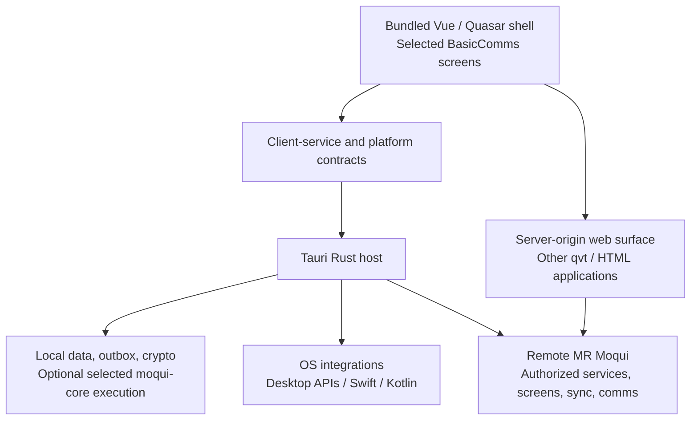

# Mobile and Desktop Clients

Status: 2026-11-02 — recommendation and tentative implementation plan. Start with Quasar + Tauri 2 as an additional MR Moqui packaging and execution option. Desktop is valuable independently of the eventual mobile choice; evaluate Tauri on iOS and Android early, and retain Quasar + Capacitor as the mobile alternative. No packaged client or platform performance results are claimed here.

## 1. Direction and rationale

Build a locally installed client with the existing Vue/Quasar UI, a Rust host, selected bundled application screens, and access to the remaining server-delivered applications. Begin with Tauri on desktop. Keep the frontend and client-service contracts usable by a Capacitor mobile host if mobile testing favors that option.

This is more than another way to open the website. Tauri makes it possible to combine remote applications with local storage, native integrations, and eventually selected in-process MR Moqui execution. An offline-capable desktop application is a significant objective, even if the phone application ultimately uses a different host.

The main reasons for this direction are:

- **Reuse:** preserve the Vue/Quasar components, JavaScript libraries, screen contracts, and application behavior already used by the web client. Avoid maintaining a second default UI in React or native widgets.
- **Rust performance and memory management:** put suitable storage, synchronization, cryptography, and local framework work in native Rust, consistent with the reasons for using Rust in MR Moqui. Control allocations, ownership, concurrency, and cache sizes in these paths.
- **Architectural flexibility:** support a remote client, a client with offline data and queued operations, and an optional local runtime through the same shell. A listening HTTP server and a complete server installation should not be prerequisites for opening the application.
- **Platform reach:** target macOS, Windows, and Linux, with an early iOS/Android feasibility track. Platform-specific work should sit behind explicit adapters.

Tauri accepts web frontends and a Rust backend, with Swift/Kotlin available for platform integration. Its use of the platform WebView avoids packaging an entire independent browser engine with every application. These are useful architectural properties, not evidence that this application will automatically start faster or use less memory than every alternative. [Tauri overview](https://v2.tauri.app/start/).

Here, a **bundled screen** is installed with the application and can open without downloading its UI from a server. It remains a Vue/Quasar DOM interface inside a WebView. Native OS behavior, such as incoming-call integration, comes from platform APIs; bundling a screen does not turn its controls into UIKit or Android widgets.

## 2. Existing foundation and gaps

The broader host-portability direction is in [Cross-Platform Usability](proposals/Usability.md). This plan makes the desktop/mobile client choice concrete while preserving the existing web and browser-local options.

| Existing area | Useful starting point | Work still required |
|---|---|---|
| [Webroot client and libraries](../runtime/base-component/webroot/screen/webroot/README.md) | Vue 3, Quasar 2, Moqui widgets, localization, rich text, charts, Markdown, and other browser libraries already form a complete web UI. | Package selected assets locally; make paths, configuration, transport, and lifecycle host-independent. The current vendored/global-script layout is not already a Quasar CLI application. |
| [qvt client](../docs/ui/Qvt-Client.md) | Both server-merged templates and `server-static` compiled templates are supported. The latter separates a reusable render function from actions data. | Negotiate compatible client/template versions, package selected screens, and define which data/actions can work offline. |
| [BasicComms](../runtime/base-component/basic-comms/README.md) | Chat, inbox, and compose screens already use Quasar, with JSON transitions for data and mutations. | Extract reusable presentation and client logic without copying the application. Keep server-side services, authorization, and extensions authoritative. |
| [Shell and extension contracts](../docs/ui/Qvt-Client.md#shell-data-and-providers) | Shell discovery, app routes, counts, providers, and screen extensions allow the default client to work with different application compositions. | Preserve these contracts in the packaged shell instead of hardcoding a particular BOSS or BasicComms deployment. |
| [Core framework](../crates/moqui-core/Cargo.toml) | `moqui-core` has no listening socket or database driver; host responsibilities are already separate. | Audit the selected dependency/features set and supply native client storage, lifecycle, and execution adapters. |
| [Browser host](../crates/moqui-browser/src/host.rs) and [WASM work](archive/Wasm.md) | A local SQLite-backed framework host exists; its library also builds natively. It demonstrates local entity/service/screen execution without the normal server host. | It explicitly has no login flow and disables authorization for service calls/entity finds. It is groundwork, not a production authenticated offline client. |
| [PWA and Web Push](../docs/ui/Qvt-Client.md#install-and-web-push) | Versioned shell-asset caching and browser notifications already exist. | The current PWA is not an offline application/data replica and is not native APNs/FCM or incoming-call support. |

### qvt reuse

The two existing qvt paths need to remain distinct:

- **Server-merged qvt:** the server merges actions and templates, then the browser compiles/renders the Vue result. It is a useful online compatibility path.
- **Server-static qvt:** the server delivers compiled JavaScript registering a render function in `moqui.qvtStatic[path]`; the client obtains screen data from `<path>/actions` and list/tree data from the corresponding action endpoints. This is the better starting point for reusable templates and separately managed data.

“Server-static” does not mean offline, and does not mean that only data arrives from the server. The render function is executable JavaScript; actions may still require server services. A fully server-rendered HTML screen can also remain available in the remote surface where appropriate.

There is already a [precompiled component render bundle](../runtime/base-component/webroot/screen/webroot/js/WebrootVue.qvt.render.js). [WebrootVue.qvt.js](../runtime/base-component/webroot/screen/webroot/js/WebrootVue.qvt.js) applies those renders when template hashes match, and [qapps.xml](../runtime/base-component/webroot/screen/webroot/qapps.xml) loads the bundle. Some prose in the qvt guide/webroot README still describes that precompilation as future work; implementation planning should use the current source and verify coverage, including late-registered components and packaged `.qvue` screens.

The current [MoquiLib loader](../runtime/base-component/webroot/screen/webroot/js/MoquiLib.js) uses relative URLs, same-origin credentials, CSRF tokens, and `new Function` when evaluating component scripts. A local application origin changes those assumptions. Precompile the bundled UI and introduce transport/configuration adapters; do not assume copying the webroot directory produces a working authenticated client or removes dynamic-code requirements from every remote screen.

### Comms reuse

Start with BasicComms chat and mail presentation, using their existing JSON contracts. Preserve `comms_app_root`, provider discovery, and `screen-extend`/extension actions so that the same installed client can connect to BasicComms or an application such as BOSS that mounts and extends it.

The JavaScript is not uniformly portable. [WebrootChat.js](../runtime/base-component/webroot/screen/webroot/js/WebrootChat.js) mixes reusable state handling with browser storage, connectivity, and visibility. [WebrootCall.js](../runtime/base-component/webroot/screen/webroot/js/WebrootCall.js) depends on browser media APIs and signaling. [WebrootCrypto.js](../runtime/base-component/webroot/screen/webroot/js/WebrootCrypto.js) uses the Matrix crypto WASM package, IndexedDB, and browser coordination primitives. Extract adapters around these responsibilities rather than rewriting all of them in Rust immediately.

## 3. Candidate research and disposition

| Candidate | Fit for this project | Disposition |
|---|---|---|
| **Quasar + Tauri 2** | Retains the Vue/DOM UI while adding a Rust host and desktop/mobile packaging. A natural place to integrate selected MR Moqui Rust capabilities. | Start here. Desktop remains a target regardless of mobile outcome. Mobile viability depends especially on comms and lifecycle integration. |
| **Quasar + Capacitor** | Preserves the same Quasar UI and has a documented Quasar mobile workflow with native plugins. Rust can still sit behind a custom Swift/Kotlin plugin. | Retain as the mobile option if it materially reduces integration or maintenance work. It does not replace the Tauri desktop direction. [Quasar Capacitor integration](https://quasar.dev/quasar-cli-vite/developing-capacitor-apps/introduction/). |
| **NativeScript-Vue** | Vue programming model with native controls, but existing HTML/Quasar components and DOM libraries are not native-control components. | Consider only if native widget UI becomes a requirement worth a substantial presentation rewrite. [Vue integration](https://nativescript-vue.org/), [DOM and platform differences](https://nativescript-vue.org/docs/essentials/gotchas). |
| **React Native + Expo** | Native UI and a relevant media/calling ecosystem; custom native modules use development builds. WebViews can retain remote web applications. | Useful comparison for difficult mobile integrations, but a React/native UI rewrite gives up too much current UI reuse for the default direction. [Expo native customization](https://docs.expo.dev/workflow/customizing/), [React Native WebRTC](https://github.com/react-native-webrtc/react-native-webrtc). |
| **Ionic Vue / Framework7 Vue** | Both offer Vue mobile UI systems. | Additional UI migrations without a demonstrated advantage over the Quasar already in use. Capacitor does not require adopting Ionic UI. [Ionic Vue](https://ionicframework.com/docs/vue/overview), [Framework7 Vue](https://framework7.io/vue/introduction/). |
| **Rust-authored UI, e.g. Dioxus or Slint** | Can move UI authorship toward Rust, with a different component/rendering model. | Not the initial path: it reduces reuse of the current Vue/Quasar UI. Using Rust for the host does not require a Rust UI rewrite. [Dioxus](https://github.com/DioxusLabs/dioxus), [Slint](https://slint.dev/faqs). |

The Quasar + Tauri combination is a web frontend integrated with a Tauri host; it should not be treated as the same ready-made Quasar CLI mode as Capacitor. Decide the asset build/staging arrangement during the first milestone. Avoid making a conversion of every existing web application to a new frontend toolchain a prerequisite.

## 4. Proposed architecture

The remote surface is a navigation/content boundary, not a promise that a particular iframe or child-WebView arrangement works on all targets. Choose that mechanism after checking embedding policy, navigation, cookies, file handling, and mobile support.

### Bundled shell and host contracts

Bundle startup, server/account selection, settings, navigation, and an initial BasicComms subset. Keep shell startup independent of network availability. Obtain authorized remote application entries and extension data from the selected server after login.

Define a small shared client API for requests, account identity, persistence, connectivity, notifications, files, deep links, and lifecycle events. Provide browser and Tauri implementations, and allow a Capacitor implementation later. Keep general UI state in Vue; keep durable client records and native operations behind these contracts. Use explicit result/error types and cancellation rather than exposing an arbitrary native service executor to JavaScript.

Tauri commands can connect the bundled frontend directly to Rust. This permits an in-process client backend without a localhost HTTP service. A loopback server may be useful for a specific compatibility requirement, but it should be an explicit optional choice. [Calling Rust from Tauri](https://v2.tauri.app/develop/calling-rust/).

Keep Tauri and mobile platform dependencies at the host boundary. Follow [Rust practices](../docs/dev/Practices-Rust.md) and [Crate-Split](Crate-Split.md) when choosing module/crate placement. Extract reusable SQLite or runtime pieces from the browser work only where required; do not make a desktop host depend on browser-specific fetch/worker infrastructure or pull the full server host into the default client.

### Remote applications and authentication

Initially, load remote applications with their own server-compatible qvt runtime in a separate server-origin surface. This preserves broad screen compatibility while the bundled shell evolves. Sharing compiled remote screens inside the shell can be explored later with an explicit compatibility contract; it should not silently mix different Vue, Quasar, and Moqui widget versions.

Define the remote API base URL, app root, server identity, account identity, and supported client features explicitly. Handle session expiry, CSRF rotation, reauthentication, redirects, downloads, and logout. A local-origin WebView request, a native HTTP request, and a server-origin WebView may have different cookie stores and credential behavior; establish a deliberate login/session handoff instead of assuming automatic sharing.

The packaged shell receives narrowly scoped native capabilities. Remote content receives no general filesystem, key-store, database, or shell-command access. If it needs a native operation, use an explicitly allowed, validated bridge. Tauri supports capability scopes by window/WebView and remote origin; configure these for the actual content separation and test navigation between origins. [Tauri capabilities](https://v2.tauri.app/security/capabilities/).

Loading a remote `.qvue` script or compiled render function into the bundled shell would execute it in that shell's context. Any later shared-runtime approach must account for that privilege change as well as version compatibility; an origin allowlist alone does not isolate scripts after they are loaded into the privileged page.

For a Capacitor variant, retain the locally bundled shell. Its `server.url` and navigation configuration are documented primarily for development/live reload, not as a production remote-shell architecture. An embedded browser also needs its own authentication/storage design. [Capacitor configuration](https://capacitorjs.com/docs/config), [InAppBrowser](https://capacitorjs.com/docs/apis/inappbrowser).

### Optional local framework execution

Treat three configurations separately:

1. **Remote client:** bundled UI and native integrations; business operations run on the server.
2. **Offline-capable client:** local records, attachments, drafts, search, and durable queued mutations; the server validates synchronized changes.
3. **Selected local runtime:** packaged definitions and services execute through `moqui-core` with an appropriate local database and host capabilities. A desktop-only full local server deployment is another possible configuration, not the required implementation of this one.

Move through these configurations incrementally. Opening a bundled chat screen should not require booting every framework tool, loading every component, or starting Postgres. Conversely, a locally rendered business screen is not useful offline unless its actions, entities, services, and resources are also available locally.

## 5. Rust and mobile feasibility

Rust is a practical shared implementation language for storage, synchronization, networking, cryptography, parsing, and business rules on both Apple and Android platforms. Rust documents iOS and Android targets, while the platform SDKs/toolchains are still required. Compile the actual selected MR Moqui dependency graph early: support for Rust itself does not prove that every crate or native dependency in the server build works on mobile. [Rust iOS targets](https://doc.rust-lang.org/rustc/platform-support/apple-ios.html), [Rust Android targets](https://doc.rust-lang.org/rustc/platform-support/android.html).

For Tauri, keep portable work in Rust and use Swift on iOS and Kotlin/Java on Android for platform APIs and lifecycle entry points. Native plugin code can call Rust without routing every operation through JavaScript. That matters when the WebView is suspended, although it does not grant unlimited background execution. [Tauri mobile plugins](https://v2.tauri.app/develop/plugins/develop-mobile/).

If Capacitor is chosen for mobile, the same Rust library can be exposed through native plugins, potentially with UniFFI-generated Swift/Kotlin bindings. This adds binding, packaging, and lifecycle work; it is not a switch that makes a Tauri plugin a Capacitor plugin. [UniFFI](https://mozilla.github.io/uniffi-rs/latest/).

| Responsibility | Initial implementation direction |
|---|---|
| Screens, forms, responsive layouts | Existing Vue/Quasar and selected shared JavaScript. |
| Persistence, outbox, sync state, suitable computation | Native Rust, with bounded background work and an explicit account/server scope. |
| Optional local entity/service/screen execution | Selected MR Moqui Rust/QuickJS capabilities after dependency and semantic checks. |
| Push registration, secure credential storage, deep links, permissions, sharing | Existing suitable plugins or small platform adapters. |
| Incoming calls, audio sessions/routes, background transfers | OS-specific integration; Rust can share state/protocol logic. |
| Media capture, codecs, WebRTC transports | Evaluate existing browser media first; native media is a separate implementation and interoperability task. |

### Comms is the key mobile gate

The current browser call and crypto implementation is useful starting code, not proof of a production phone client. Validate microphone/camera permissions, Bluetooth and speaker routing, interruptions, lock-screen behavior, push delivery, notification actions, and resumed/killed-process behavior on real iOS and Android devices.

Incoming-call UI, wake-up/signaling, and the media engine are separate responsibilities. CallKit/Android Telecom integration does not itself implement WebRTC or the Moqui SFU protocol. A relevant reference is [react-native-callkeep](https://github.com/react-native-webrtc/react-native-callkeep), whose scope is native call integration, alongside the separate WebRTC library.

Native push needs a device-registration and delivery path using APNs/FCM as appropriate; the existing browser VAPID subscriptions are not interchangeable. Do not infer full push or VoIP support from a generic notification API. Even Capacitor's push plugin documents limits around iOS silent pushes and Android killed-process handling. [Tauri notifications](https://v2.tauri.app/plugin/notification/), [Capacitor push notifications](https://capacitorjs.com/docs/apis/push-notifications).

iOS background work is system-controlled; Android also distinguishes deferred work, foreground services, and specific platform use cases. Design short resumable operations and native callbacks, with reliable state persisted before suspension. Rust threads and a WebSocket do not provide an always-running phone service. [Apple background strategies](https://developer.apple.com/documentation/backgroundtasks/choosing-background-strategies-for-your-app), [Android background work](https://developer.android.com/develop/background-work).

### Crypto and media compatibility

The existing Matrix crypto WASM library has a Rust foundation. The upstream Matrix Rust SDK is used by Element X on iOS and Android, and includes a standalone crypto crate. This makes native crypto reuse a concrete candidate, but MR Moqui's `/ChatKeys` transport and device model are not the Matrix client/server API; adopting the complete Matrix client SDK would not automatically implement them. [Matrix Rust SDK](https://github.com/matrix-org/matrix-rust-sdk), [existing chat-key design](../docs/interfaces/Chat-Keys.md).

Choose one crypto-state owner per packaged-client device. If using native crypto, verify key persistence, recovery, verification, concurrent access, and compatibility with existing browser devices; do not assume IndexedDB and native stores are interchangeable. A new native device identity may be safer than a first-release store migration. Keep the browser implementation usable for the web client.

[WebrootCallKeys.js](../runtime/base-component/webroot/screen/webroot/js/WebrootCallKeys.js) requires browser transform/worker/crypto support for encrypted calls. Test the actual WebView capabilities on supported OS versions and preserve fail-closed behavior. If a native media engine is needed, its signaling, SFU behavior, and frame-encryption integration must interoperate with the existing [WebRTC design](../docs/interfaces/WebRTC.md); silently dropping encryption is not a fallback.

## 6. Offline behavior and data ownership

Offline capability is an application contract, not a packaging feature. Start with a small useful set: opening the shell, viewing explicitly cached conversations or mail, editing drafts, and showing clearly pending operations. Select the exact read/write scope in the first milestone.

The tentative persistence/sync design should include:

- A local store partitioned by stable server and account identity, schema migrations, bounded attachment/cache retention, and deliberate sign-out/account-removal behavior. Store credentials and encryption keys through an appropriate protected native store; SQLite alone does not provide an encryption policy.
- Atomic recording of a local change and its outbox entry. Use stable operation IDs and server-side idempotency so retries after a lost acknowledgement do not duplicate sends or other effects.
- Explicit queued, sending, acknowledged, retryable-failure, and rejected states. Preserve failed drafts and identify the affected item; one independent failure must not stop unrelated synchronization. Respect real dependencies between operations.
- Cursor/revision-based incremental synchronization, deletion/tombstone handling, reconnect recovery, and a policy for expired cursors or required resynchronization. Avoid relying on wall-clock timestamps alone.
- Domain-specific conflict rules. Sending a message, editing a draft, changing a shared record, and transitioning a business document do not necessarily have the same merge semantics.
- Server reauthorization of every accepted mutation. Offline UI permissions are cached hints; access revocation and changed business state can reject a previously queued action. Define what happens to cached data after revocation when connectivity returns.

Do not assume these server sync APIs already exist. Reuse current transitions where suitable, then design the missing revision, acknowledgement, and idempotency contracts jointly with the client. Reconcile this work with [Messaging](proposals/Messaging.md), without making its entire proposal a prerequisite for the first client.

For local framework execution, audit SQLite dialect coverage and transaction semantics as well as schema compatibility. The existing browser host uses a shared SQLite handle; nested logical transactions use savepoints rather than independent commits, with consequences for `requires-new` behavior. That implementation cannot be transplanted unchanged and called equivalent to the server. Authentication/authorization, unavailable host tools, selected services, search, and resource access all need an explicit supported subset. See [WASM limitations and follow-up](archive/Wasm.md).

## 7. Performance and memory criteria

Performance is a reason to prefer this architecture and a criterion for its implementation. Native Rust can avoid unnecessary interpreter work for suitable operations and gives direct control over allocation lifetimes and resource bounds. In-process calls may remove HTTP and serialization layers from local execution. The benefit depends on where the work actually occurs and what crosses the frontend/backend boundary.

The UI still incurs WebView rendering, JavaScript garbage collection, and DOM costs. Tauri uses WebView2 on Windows, WKWebView on Apple platforms, WebKitGTK on Linux, and the system Android WebView. These differ in capability and performance; the Rust host's memory alone is not the application's memory footprint. [Tauri WebView versions](https://v2.tauri.app/reference/webview-versions/).

Use these implementation principles:

- Keep shell startup small. Load editors, charts, diagrams, terminal support, crypto, and the optional framework runtime when required, preserving existing lazy-loading where possible.
- Avoid duplicating complete datasets in Rust, serialized IPC messages, and Vue stores. Page large lists, bound caches/queues, and batch appropriate updates. Use file/stream-oriented paths for large attachments where supported.
- Keep blocking database/framework work off the UI thread. Respect MR Moqui execution-context and thread ownership rules rather than placing all operations on an unbounded async executor.
- Avoid a second full crypto/runtime instance for the same local responsibility. If remote screens require a separate runtime for compatibility, measure that cost explicitly.
- Make cancellation, account switching, reconnects, and window closure release resources predictably. Track memory after repeated use, not only immediately after startup.

Establish release-build baselines before making numerical claims. Compare the same workload and data on named hardware/OS versions: the current web client, the minimal Tauri client, then the client with local persistence/runtime features. Compare Capacitor on the same mobile devices if that decision is active.

Record cold/warm launch to usable UI, total app/process memory at idle and after representative use, local query/action latency, scroll/input responsiveness, IPC volume, installed/download size, and mobile wake-up/battery behavior. Set budgets from those measurements. A smaller installer is useful but is not a memory or responsiveness measurement.

## 8. Tentative implementation plan

Milestones are ordered by dependencies, not fixed dates. The mobile feasibility track starts early and can change the phone host without stopping desktop work.

| Milestone | Scope | Exit evidence |
|---|---|---|
| **MD0 — Define the first slice and seams** | Inventory reusable shell/BasicComms assets and host assumptions. Choose initial offline reads/writes, supported OS versions, host/module placement, frontend packaging, and version negotiation. Audit selected Rust/native dependencies for desktop and mobile. | A small agreed client API and asset manifest; explicit in/out scope; reproducible baseline workloads and acceptance budgets. No wholesale frontend or crate reorganization required. |
| **MD1 — Minimal Tauri desktop shell** | Bundle Vue/Quasar and one representative existing screen. Add settings, server selection, one typed Rust command, and platform-scoped capabilities. Establish packaging on macOS, Windows, and Linux, starting with the available development platform. | Installed app opens its local UI without a network; command round trip works; local resources resolve; each desktop target has build/launch evidence and recorded startup/memory results. |
| **MD2 — Authenticated remote applications** | Implement account/transport adapters, login and reauthentication, shell/app discovery, BasicComms routing/extensions, and the separate remote surface. Preserve both supported qvt modes and HTML navigation where needed. | Bundled and remote screens work against a real server; account switching, expired sessions, CSRF, links, downloads, and origin/capability boundaries behave as specified. |
| **MD3 — Local data and bundled Comms** | Add durable client storage and migrations. Package the selected chat/inbox/compose views from shared source. Provide local reads/drafts and explicit offline/pending presentation. Decide crypto-state ownership for this scope. | Previously selected content and drafts survive restart without a connection; account/server separation holds; web and packaged clients still use the shared UI/contracts. |
| **MD4 — Reliable synchronization** | Add atomic outbox, idempotency/acknowledgements, incremental sync, deletions, conflicts, and rejected-operation handling. Implement necessary server changes. | Lost acknowledgements, disconnect/restart, duplicate events, revocation, and one bad independent item do not cause duplicate effects or block unrelated work. Encryption state survives the supported lifecycle. |
| **MD5 — Optional local MR Moqui runtime** | Supply native host/storage adapters for a deliberately small component/service/screen subset. Reuse the core and applicable browser-host work; implement authorization and verify transaction behavior. | A selected real workflow runs after a disconnected restart using packaged definitions and local data. Unsupported operations are explicit, and later synchronization passes server authorization. Expand only from this proven subset. |
| **MD6 — Distribution and operation** | Complete signed desktop packages, update/version compatibility, data migration/recovery, diagnostics, and performance budgets. Add mobile distribution work once its host is selected. | Upgrade/recovery and supported-platform checks pass; failures identify the affected operation; logs exclude credentials and private message content; release behavior is reproducible. |

### Early mobile track, alongside MD1–MD3

1. Build the smallest Tauri app on an iOS device and an Android device, using the intended Rust dependency subset. Verify local shell startup, permissions, storage, deep links, and foreground/background transitions.
2. Exercise the highest-risk comms path: native push registration, incoming-call presentation, accepting/declining from the lock screen, media/audio routing, encrypted-call compatibility, and recovery after OS termination or a network change. Record unsupported OS/WebView combinations.
3. Identify which gaps need a maintained existing plugin, a small Swift/Kotlin adapter, or a separate native media implementation. Evaluate plugin platform support and maintenance, not just whether a package with the right name exists.
4. If those gaps favor Capacitor, reproduce the critical path with the same Quasar assets and shared Rust/client contracts. Compare integration scope, lifecycle correctness, performance, and ongoing maintenance. Avoid porting the whole application merely to make this comparison.
5. Select the mobile host from that evidence. Tauri desktop and the shared frontend/Rust work continue in either case. A successful foreground WebView demonstration alone is not the mobile acceptance gate.

### Validation and rollout

Use fast Rust unit tests and the existing `moqui test`/`moqui test-client` facilities for shared logic and client contracts; Node is not a new test dependency. Add focused boundary tests for account separation, command permissions, outbox idempotency, and lifecycle state handling. Frontend packaging tools may have development dependencies without making them server/runtime/test requirements.

Use device and integration scenarios for the behavior they alone can establish. Follow [Build-Test](../docs/Build-Test.md#slow-tests): do not run slow tests or prolonged device/performance scenarios without the user's explicit permission for the needed scenario. This document does not authorize those runs.

Before mobile distribution, check the actual remote-application and local-code model against store requirements. Apple's guidelines distinguish downloaded feature-changing code, minimum app functionality, and permitted HTML5/JavaScript software; section 4.7 has additional conditions. This is an implementation/distribution decision to validate, not an assumption that either every remote screen is forbidden or any WebView container is automatically accepted. [Apple App Review Guidelines, §§2.5.2, 4.2, 4.7](https://developer.apple.com/app-store/review/guidelines/). Google Play likewise distinguishes downloaded executable code from interpreted code while imposing requirements on both. [Google Play device and network abuse policy](https://support.google.com/googleplay/android-developer/answer/16559646).

## 9. Decisions to settle during implementation

- Which BasicComms views and mutations make up the first useful offline release, and which broader business workflow justifies the first local framework slice?
- What is the minimum OS/WebView matrix, especially for encrypted calls, and what native media work is acceptable?
- Which authentication handoff supports both the bundled client and remote application surface without duplicating credentials or weakening server checks?
- Which existing assets can be packaged directly, and where is extraction/precompilation needed to keep one source for web and installed clients?
- What is the durable client schema, crypto-device policy, credential/key-storage choice, and treatment of retained offline data?
- What compatibility handshake covers shell assets, server APIs, remote compiled templates, local definitions, and local schema migrations?
- What measured latency/memory/startup budgets define success, and which optional features remain unloaded in the default client?

The first implementation should deliver MD0 and a small MD1 vertical slice, while starting the mobile dependency/lifecycle checks. It should demonstrate the packaging and Rust/UI boundary before expanding into offline synchronization or a general local server.
